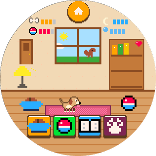
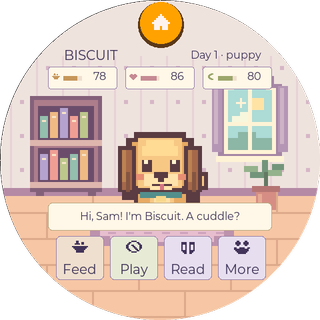
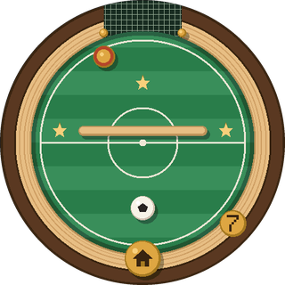
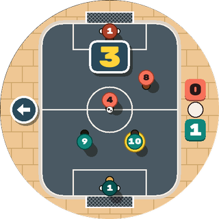
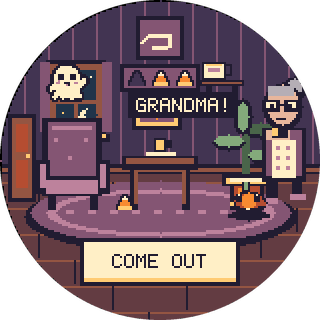
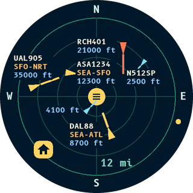
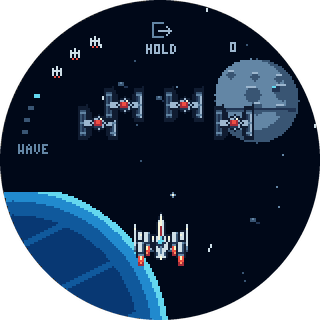
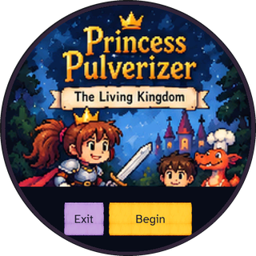
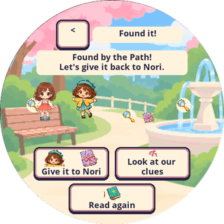
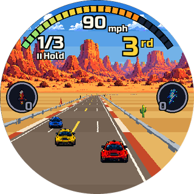

# porthole
[](https://github.com/dreamiurg/porthole/actions/workflows/ci.yml?query=branch%3Amain+event%3Apush)
[](https://github.com/dreamiurg/porthole/actions/workflows/release.yml)
[](https://github.com/dreamiurg/porthole/releases)
[](https://github.com/dreamiurg/porthole/releases/latest)

> Small games for one round touchscreen, and the tools to build, test, release and flash them.

The screen is the Waveshare ESP32-S3-Touch-LCD-2.1. It is a 2.1-inch round 480x480 touchscreen with an
ESP32-S3 behind it. In a 3D-printed case, it is a pocket toy with no buttons. Each directory under
[`apps/`](apps/) is one complete project for this screen. The shared parts live here once: board
config, build and flash commands, CI tests, release images and screenshots.

Fork it, play the games, and make your own.

## Games

All ten games run in one firmware, [Porthole](apps/porthole/). Each kid gets a profile, up to four per board.

| | | | | |
| :---: | :---: | :---: | :---: | :---: |
| <br>**Pets Club** | <br>**Biscuit** | <br>**Marble Kick** | <br>**Tilt FC** | <br>**Pumpkin Hide & Seek** |
| <br>**Radar** | <br>**Starfighter** | <br>**Kingdom** | <br>**Toy Town** | <br>**Rally** |

- **Pets Club:** a pixel puppy grows over real days. It learns eight tricks and listens to 30 stories.
- **Biscuit:** a full-color pup. Read branching stories with him and find 96 illustrated discoveries.
- **Marble Kick:** tilt the board to roll a marble through 12 labyrinth levels.
- **Tilt FC:** top-down street football. Tilt to run. Tap to pass or shoot.
- **Pumpkin Hide & Seek:** hide from Grandma, take three candies, and escape through the door.
- **Radar:** live planes near your home, on a radar screen.
- **Starfighter:** bank the board to fly and tap to fire. Then fly the trench.
- **Kingdom:** a story game in 40 scenes. Each choice changes the world later.
- **Toy Town:** a doll town with a school, a café and a park, each with a short activity.
- **Rally:** hold the board like a wheel and race three rivals on four tracks.

No game punishes a kid who is away. Nothing dies, and no progress is lost.

**[Put the games on a board](https://dreamiurg.net/porthole/)** from Chrome, with no tools to install.
To try them on a computer, run `make -C apps/porthole webemu`. [More about Porthole](apps/porthole/README.md).

## How this started

It started with a MakerWorld project,
[ESP32 Plane Radar](https://makerworld.com/en/models/2872376-esp32-plane-radar-live-ads-b-on-a-round-display)
by [MatixYo](https://github.com/MatixYo/ESP32-Plane-Radar). A small ESP32 board with a 1.28-inch round
screen reads live flight data and shows the planes overhead on a radar. I built one with my kids. Then I
showed them how to change it with Claude Code. They asked for changes and watched them appear on the
screen. I loved that.

Next we bought a bigger round screen, the Waveshare board this repo uses. In one sitting with Claude and
Codex, we had a few games running on it. My kids loved them, so I shared them with friends, and their
kids loved them too. This repo is the clean home for those games. Anyone can add the next one.

If you like to tinker and have $35-45 for a board, have fun with it.

## Get a board

Every app here runs on the **Waveshare ESP32-S3-Touch-LCD-2.1** ($35-45):

- [Amazon](https://www.amazon.com/dp/B0DDPQSKJD): about $45, usually the fastest shipping.
- [Waveshare](https://www.waveshare.com/esp32-s3-touch-lcd-2.1.htm): about $35, the maker's own store.

Get the exact 2.1-inch flat model, `ESP32-S3-Touch-LCD-2.1`. Waveshare sells similar round boards in
1.28, 1.85 and 2.8 inch. Those do not run these apps. A curved-glass version (`ESP32-S3-Touch-LCD-2.1B`)
also exists. We did not try it.

Why this board works well for toys:

- The round screen feels like a toy, not a small phone.
- Touch is the only input, so it fits a case with no buttons.
- It has enough memory to double-buffer the full screen, so animation is smooth.
- A real-time clock keeps time while the board is off.
- Arduino and PlatformIO work. One USB-C cable gives power, flashing and the serial console.
- A motion sensor gives tilt to Marble Kick, Tilt FC and the other tilt games. Wi-Fi gives updates and Radar.

[docs/hardware.md](docs/hardware.md) has the full specs.

### Other boards

The apps support one board only. I do not plan to port them. To use another board, fork the repo and ask
Claude Code or Codex to adapt the code, starting from [docs/hardware.md](docs/hardware.md). Most
board-specific code is in `apps/porthole/firmware/board.cpp` and `platform/waveshare-round.ini`. A screen
of a different size or shape also needs new layouts, because the games are drawn for a 480x480 circle.
If you make another board work, send a pull request. If you are stuck, open an issue.

## Getting started

You need Python 3.11+, Node 22, a C++17 compiler, and PlatformIO for firmware. Host builds also need zlib
(`zlib1g-dev` on Debian/Ubuntu, included in the macOS SDK).

```sh
git clone https://github.com/dreamiurg/porthole.git
cd porthole
pip install -r platform/requirements.txt          # PlatformIO Core and pinned builder deps
pip install pillow fonttools==4.61.1 'gcovr>=8.3'  # art and font checks, coverage
make hooks                                        # the CI checks, run on commit and push
make check                                        # lint and tests for every app
```

Flash a board over USB-C. PlatformIO finds the port when you connect one board.

```sh
make flash APP=porthole
make flash APP=porthole PORT=/dev/ttyUSB0
make monitor
```

### Install from the browser

This way needs no tools:

1. Download `<app>-<version>-factory.bin` from the [releases](https://github.com/dreamiurg/porthole/releases).
2. Connect the board over USB-C.
3. Open [esptool-js](https://espressif.github.io/esptool-js/) in Chrome or Edge.
4. Write the file at address `0x0`.

This erases the board, saved progress included. To keep saves, write the separate parts from
`<app>-<version>-web.zip` at the offsets in its `parts.json`. The web installer does this. You can also
build from source and run `make flash`. With esptool, from the unzipped parts:

```sh
esptool --chip esp32s3 write-flash 0x0 bootloader.bin 0x8000 partitions.bin 0xe000 boot_app0.bin 0x10000 firmware.bin
```

esptool 4 spells the command `write_flash`. Do not give `--flash-mode` or `--flash-freq`. They change the
bootloader header, and a mode the board cannot run (`qio`) puts it in a watchdog reset loop. To recover,
write the parts again without those options. A step-by-step guide with pictures is at
[dreamiurg.net/porthole](https://dreamiurg.net/porthole/).

### Updates over Wi-Fi

You need the USB cable only once. After that, the board updates itself over Wi-Fi.


Once a day, when nobody plays and the screen is dark, the board looks for a new version and downloads it.
The screen dims by itself after a few minutes. If someone wakes the screen, the download stops. It
continues the next time the screen is dark. The new version starts the next time someone switches the
board on, and the kids see a "Porthole has something new!" card. Saves and profiles stay. The board sends
nothing about the kids.

To give the board your Wi-Fi, use one of these:

- **On the board (easiest).** Open the hidden menu (below) and tap **Wifi**. Pick your network and type
  its password. The board tries it at once and keeps it only if it connects, or if you tap **Save anyway**.
  A network with no password skips the typing.
- **microSD card.** Make the file `/porthole/wifi.txt`. Put the network name on line 1 and the password on
  line 2. Put the card in the board and switch it on.
- **USB cable.** Open a serial monitor at 115200 baud on either USB-C port. Send `W`, the network name, a
  tab, and the password, for example `WHomeWiFi`, a tab, then your password.

Grown-ups have a hidden menu. On "Who's playing?", hold the title for 5 seconds.

- **Info** shows the version, the Wi-Fi, the SD card and other details.
- **Wifi** lists the networks near the board.
- **Updates** shows the running and newest versions and lets you pick Stable or Beta. **Check now**
  downloads at once (about a minute, with a percentage and a Cancel control). **Restart now** appears when
  an update is ready.

The running version also shows in small print at the bottom of "Who's playing?".

- **Stable** (the default) gets a beta after two days with no newer beta.
- **Beta** gets each new version as soon as the release workflow builds it.

### Beta and stable

Each release starts as a GitHub pre-release. That is **beta**. Promotion to **stable** makes the release
GitHub's "Latest" and moves the `stable` branch to it.

- The **Promote** workflow runs each morning. It promotes the newest beta when that beta was the newest
  for 48 hours. So a beta that needed a fix never reaches stable.
- To promote now, open Actions, pick **Promote**, and run it with a tag. An empty tag means the newest
  pre-release.
- To roll stable back, promote an older tag. This helps only boards that did not update yet. A board never
  installs an older version by itself, so a board on a bad build needs a USB flash.

Each release also has `<app>-<version>-ota.bin` (the app image alone) and `<app>-version.txt` (the bare
version string) for boards that update themselves. A rolling `<app>-beta` pre-release holds a copy of the
newest `<app>-version.txt`, and beta boards read it there. `tools/check_channel.sh porthole stable|beta`
finds a channel's version and image the same way a board does. The release and promote workflows run it
after they publish.

## Make your own app

Copy the shape of an existing app into `apps/<your-app>/`. An app needs:

- a `Makefile` with the shared targets (`lint`, `test`, `check`, `coverage`, `ci`, `firmware`, `flash`,
  `factory`),
- a PlatformIO project that extends the shared board config,
- a README,
- two screenshot strips made with `tools/gallery.py`.

The full checklist is in [docs/new-app.md](docs/new-app.md).

What you get:

- **Pinned board config.** [`platform/waveshare-round.ini`](platform/waveshare-round.ini) sets the
  PlatformIO platform, PSRAM and flash. [`platform/requirements.txt`](platform/requirements.txt) pins
  PlatformIO.
- **The same commands for each app:** `make check`, `make ci`, `make firmware APP=...` and
  `make flash APP=...`.
- **Early checks.** Pre-commit hooks check formatting, secrets, SAST, mypy and the changed app's tests.
  Pre-push adds the complexity limit, playtests, coverage and the firmware build. CI runs the same checks
  on each PR, only for the apps it changes, and the full suite on each push to `main`.
- **Automatic releases.** After CI passes on `main`, each new `feat:` or `fix:` in an app makes a new
  version of that app. The release workflow publishes it as a beta with notes and a flashable factory image. See
  [Releases](https://github.com/dreamiurg/porthole/releases).

## Layout

```
apps/<app>/         one complete project per directory
platform/           shared PlatformIO base, pinned requirements, factory-image script
tools/gallery.py    README screenshot strips from panel captures
docs/               hardware.md (board, pins, round-screen rules), new-app.md (the app contract)
.github/            CI, releases, Dependabot
.claude/            agents and skills for AI-assisted work (see AGENTS.md)
```

## Contributing

Fixes, new stories and new apps are welcome. Make a branch, run `make hooks` once, and open a PR with a
conventional-commit title. [CONTRIBUTING.md](CONTRIBUTING.md) has the details.

## License

[MIT](LICENSE). Bundled fonts keep their own licenses: SIL OFL for most, public domain for font8x8.
