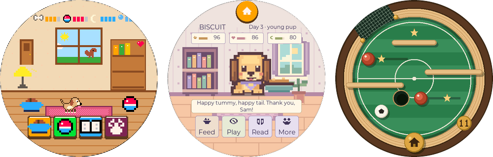
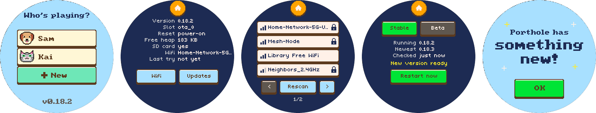

# porthole
[](https://github.com/dreamiurg/porthole/actions/workflows/ci.yml)
[](LICENSE)
[](docs/hardware.md)

> A growing collection of small apps for one round touchscreen, with a shared
> toolchain to build, test, release and flash every one of them.

The screen is the Waveshare ESP32-S3-Touch-LCD-2.1: a 2.1-inch round 480x480
touchscreen with an ESP32-S3 behind it. In a 3D-printed case it becomes a
pocket gadget with no buttons at all. Each directory under [`apps/`](apps/) is a
complete, self-contained project for that screen: a game, a toy, a tool. The
plumbing they all need lives here once: board config, build and flash commands,
tests in CI, release images, screenshots.

New apps land here as they get made. Fork it, play with them, build your own.

## How this started

It started with a small project on MakerWorld,
[ESP32 Plane Radar](https://makerworld.com/en/models/2872376-esp32-plane-radar-live-ads-b-on-a-round-display)
by [MatixYo](https://github.com/MatixYo/ESP32-Plane-Radar). A tiny ESP32 board
and a 1.28-inch round screen pull live flight data from the internet and draw
the planes overhead on a little radar. I built one with my kids, and then I
showed them how to change it with Claude Code. They asked for changes and
watched them show up on the little screen. I loved that.

So we went one step further and bought a bigger round screen, the Waveshare
board this repo is built for. In one sitting with Claude and Codex we had a
couple of games running on it. My kids loved them so much that I shared them
with friends, and their kids had a blast too. This repo is the cleaned-up home
for those games, set up so anyone can add the next one.

If you like to tinker and have $35-45 for a board, or a spare one lying in a
drawer, have fun with it. Enjoy the new era of tinkering.

## Apps

**[How to put a game on a board](https://dreamiurg.net/porthole/)**: download it from the releases and write it from Chrome, no tools needed.

| App | What it is | Runs on a computer |
| --- | --- | --- |
| [Porthole](#porthole) | The device firmware, with four games inside: Pets Club, a pixel puppy that grows over real days, learns tricks and gets read to; Biscuit, a full-color pup to read stories and discover things with; Marble Kick, a tilt-controlled marble labyrinth; and Tilt FC, tilt-controlled street football. A profile for each kid, up to four per device. | Browser emulator |

### Porthole

[](apps/porthole/)

The firmware that turns the round screen into a games device, with four games. The first is
Pets Club: a Tamagotchi-style puppy drawn in a 32-color retro palette. It grows from puppy
to grown dog over real calendar days, learns eight tricks through three lessons
each, and loves being read to: 30 original stories across three reading levels,
matched to the kid's age. Fetch and spelling games, daily gifts, stickers and
hats keep kids coming back. Up to four kids get a profile each (a face, an age,
an optional 4-digit code) and their own pup and house on Paw Street; after a few
minutes of play a kid rests so the next one gets a turn. Nothing ever dies.

The second is Biscuit, a warm companion pup drawn full-color at the panel's native
resolution. He shares seven branching stories, each with two endings to choose
between, and 96 illustrated, sourced discoveries in 12 topics, three new ones a day.
A small daily adventure earns stickers, and he learns six tricks. No streaks, no
countdowns, nothing lost for time away.

The third is Marble Kick: tilt the device and a ball rolls like a marble through a
wooden labyrinth seen from above, using the board's own motion sensor. Twelve puzzle
levels ramp from a straight tilt to the goal up to walls, holes, moving defenders, a
keeper and a moving goal, with three optional stars per level for the long way round.
Nothing is timed or scored, and every level ships with a proven solution so it's never
actually stuck.

The fourth is Tilt FC: top-down street football on a round court, also steered by
tilt. The kid's team plays a computer team; tilt runs the kid's player, and a tap passes
to a teammate, shoots on goal, or rolls the ball ahead, depending on where it's aimed. The
computer team defends from the first match, and levels ramp up how well it plays. Nothing
punishes: no lives, and losing just means playing again.

C++, no libraries: a 160x160 indexed framebuffer scaled 3x and a native 480x480
RGB565 surface with anti-aliased text, touch and tilt input, with a host
simulator, a browser emulator and scripted playtests that audit every screen
for tap-target size, bezel clipping and contrast.
**[Read more](apps/porthole/README.md)** · try it: `make -C apps/porthole webemu`

## Get a board

Every app here runs on the **Waveshare ESP32-S3-Touch-LCD-2.1**, $35-45.

- [Amazon](https://www.amazon.com/dp/B0DDPQSKJD): about $45, usually the fastest shipping.
- [Waveshare](https://www.waveshare.com/esp32-s3-touch-lcd-2.1.htm): about $35, the maker's own store.

Get the exact 2.1-inch model. Waveshare sells look-alike round boards in other
sizes (1.28, 1.85 and 2.8 inch), and those won't run these apps. The 2.1-inch
board comes in two versions: the flat touch panel (`ESP32-S3-Touch-LCD-2.1`)
and a curved 2.5D glass one (`ESP32-S3-Touch-LCD-2.1B`). We use the flat one
because it looked easier to work with. We haven't tried the curved one.

### Other boards

Right now the apps support one board: the flat 2.1-inch
`ESP32-S3-Touch-LCD-2.1`, the one on my desk. I'm not planning to port them to
other hardware myself. This is a fun side project, so hack away. We live in the
era of AI agents: fork the repo, point Claude Code or Codex at
[docs/hardware.md](docs/hardware.md) and the app you like, and ask it to adapt
the code to your board. Most of the hardware-specific code sits in
`apps/porthole/firmware/board.cpp` and the
shared PlatformIO settings in `platform/waveshare-round.ini`. A screen of a
different size or shape also means reworking the layouts, since the games are
drawn for a 480x480 circle. If you get another board working, send a
pull request. If you get stuck, open an issue and ask.

Why this board works well for toys like these:

- The round screen feels like a toy, not a tiny phone.
- Touch is the only input, so it fits a 3D-printed case with no buttons.
- It has enough memory to double-buffer the full 480x480 screen, so animation stays smooth.
- A real-time clock keeps time while it's off, which suits anything with days and nights.
- Plain Arduino and PlatformIO work, and one USB-C cable handles power, flashing and the serial console.

It also has a motion sensor (Marble Kick and Tilt FC both read it for tilt) and Bluetooth
and Wi-Fi that no app uses yet.
[docs/hardware.md](docs/hardware.md) has the full specs and some ideas for them.

## Getting started

You need Python 3.11+, Node 22, a C++17 compiler, and PlatformIO for firmware.

```sh
git clone https://github.com/dreamiurg/porthole.git
cd porthole
pip install -r platform/requirements.txt   # PlatformIO Core + the pinned builder deps
pip install pillow 'gcovr>=8.3'            # make lint (golden screenshots, art checks) and make ci (coverage)
make hooks                                 # the same checks as CI, run on commit and push
make check                                 # lint + tests for every app
```

Flash a board over USB-C. PlatformIO finds the port when one board is plugged in.

```sh
make flash APP=porthole
make flash APP=porthole PORT=/dev/ttyUSB0
make monitor
```

### Install from the browser

The easiest way needs no tools at all: download `<app>-<version>-factory.bin` from the
[releases](https://github.com/dreamiurg/porthole/releases), plug the board in over USB-C, open
[esptool-js](https://espressif.github.io/esptool-js/) in Chrome or Edge, and write the file at
address `0x0`. This erases the board, saved progress included. To keep saves, write the separate
parts from `<app>-<version>-web.zip` at the offsets in its `parts.json` (that is what the web
installer does), or build from source and run `make flash`. With esptool, from the unzipped parts:
`esptool --chip esp32s3 write-flash 0x0 bootloader.bin 0x8000 partitions.bin 0xe000 boot_app0.bin 0x10000 firmware.bin`.
(esptool 4 spells it `write_flash`.) Don't pass `--flash-mode`/`--flash-freq`: they rewrite the bootloader's header, and a mode the board
can't run (`qio`) leaves it in a watchdog reset loop until the parts are written again without them. Step by step, with pictures of the
games: [dreamiurg.net/porthole](https://dreamiurg.net/porthole/).

### Updates over wifi

You only need the USB cable once. After that, the board keeps itself up to date over wifi.



Once a day, when nobody is playing and the screen has gone dark (it dims itself after a few minutes), the
board looks for a new version and downloads it. If someone wakes the screen during the download, it stops and
picks up again the next time the screen is dark. The new version starts the next time the board is switched on, and
the kids see a "Porthole has something new!" card. Saves and profiles are kept. Nothing about the kids is sent
anywhere.

To give it your wifi, pick one:

- **microSD card.** Make a file `/porthole/wifi.txt` with the network name on the first line and the password
  on the second. Put the card in the board and switch it on. It remembers the network.
- **USB cable.** Open a serial monitor at 115200 baud (either USB-C port works) and send
  `W<network name><TAB><password>`, for example `WHomeWiFi`, then a tab, then your password.

Grown-ups have a hidden menu. On "Who's playing?", press and hold the title for 5 seconds. **Info** shows the
version, the wifi, the SD card and a few other details. **Updates** shows the running and newest version, lets you
pick Stable or Beta, and has **Check now** (it downloads right away, about a minute, with the progress on screen) and **Restart now** once an update is ready. The running version is also in small print at the bottom
of "Who's playing?".

- **Stable** (the default) gets versions I've tried and promoted.
- **Beta** gets every new version as soon as it's built.

### Beta and stable

Every release starts as a GitHub pre-release: that is **beta**. A person promotes a release to
**stable**, which makes it GitHub's "Latest" and moves the `stable` branch to it. To promote, open
Actions, pick **Promote**, and run it with a tag (empty means the highest-versioned pre-release). Promoting
an older tag rolls stable back for boards that have not updated yet; a board never installs an
older version by itself, so one already on the bad build needs a USB flash. Each release also carries `<app>-<version>-ota.bin`, the app image
on its own, and `<app>-version.txt`, the bare version string, for boards that update themselves. A rolling
`<app>-beta` pre-release holds a copy of the newest `<app>-version.txt`; boards on the beta channel read it there. `tools/check_channel.sh porthole stable|beta`
resolves a channel the way a board does (version file, then that version's image); the release and
promote workflows run it after they publish.

## Make your own app

Copy the shape of an existing app into `apps/<your-app>/`. An app needs a
`Makefile` with the shared targets (`lint`, `test`, `check`, `coverage`, `ci`,
`firmware`, `flash`, `factory`), a PlatformIO project that extends the shared
board config, a README, and two screenshot strips made with
`tools/gallery.py`. The full checklist is in [docs/new-app.md](docs/new-app.md).

What you get for free:

- Board config is pinned. [`platform/waveshare-round.ini`](platform/waveshare-round.ini)
  fixes the PlatformIO platform, PSRAM and flash settings, and
  [`platform/requirements.txt`](platform/requirements.txt) pins PlatformIO itself.
- The same commands work for every app: `make check`, `make ci`,
  `make firmware APP=...` and `make flash APP=...`.
- Quality gates run early. Pre-commit hooks cover formatting, secret
  scanning, SAST, mypy and the changed app's tests. Pre-push adds the complexity
  ratchet, playtests, coverage and the firmware build. CI repeats it once per PR
  as a cheap backstop, only for the apps a PR touches.
- Releases are automatic. Each merge that adds a `feat:` or `fix:` to an app
  tags a new version of that app, publishes a beta (pre-release) with notes and
  attaches a flashable factory image. See [Releases](https://github.com/dreamiurg/porthole/releases).

## Layout

```
apps/<app>/         one self-contained project per directory
platform/           shared PlatformIO base, pinned requirements, factory-image script
tools/gallery.py    README screenshot strips from panel captures
docs/               hardware.md (board, pins, round-screen rules), new-app.md (the app contract)
.github/            CI, releases, Dependabot
.claude/            agent roster and skills for AI-assisted work (see CLAUDE.md)
```

Board details, pins and round-screen design notes: [docs/hardware.md](docs/hardware.md).

## Contributing

Fixes, new stories, new apps: all welcome. Branch, run `make hooks` once, and
open a PR with a conventional-commit title. [CONTRIBUTING.md](CONTRIBUTING.md)
has the details.

## License

[MIT](LICENSE). Bundled fonts keep their own licenses: SIL OFL for Montserrat,
public domain for font8x8.
