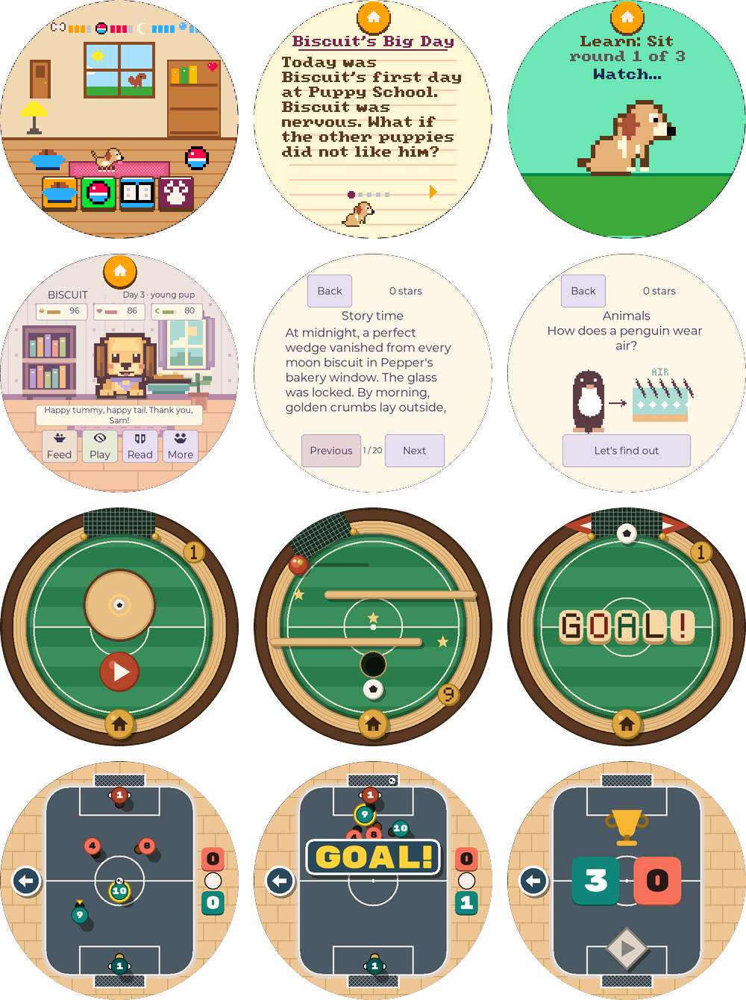
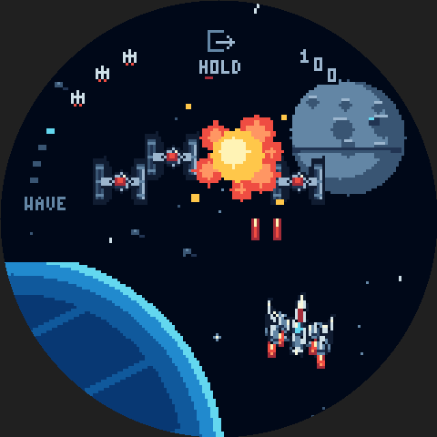
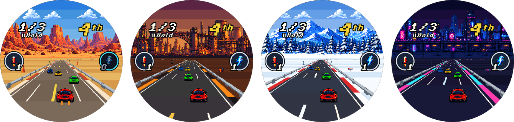

# Porthole: games for a round screen

Porthole is the firmware for the **Waveshare ESP32-S3-Touch-LCD-2.1**: a small shared runtime
(`os/`: a 160×160 indexed framebuffer with a 32-color palette and an 8×8 font, a native 480×480
RGB565 surface with smooth text, touch and tilt input from the board's QMI8658 motion sensor),
the board layer (`firmware/`), a shell (`shell/`: who's playing, a profile per kid, the game
launcher) and the games built on it (`games/`): Pets Club, Biscuit, Marble Kick, Tilt FC, Pumpkin Hide & Seek, Radar, Starfighter, Kingdom, Toy Town and Rally.



## Pumpkin Hide & Seek: a cozy Halloween game

Open **Pumpkin** (the jack-o'-lantern) on the launcher's first page. Tap to start, hold the device comfortably,
then tap **READY** to set that grip as level. Tilt left and right to roll; near the chair,
table or plant, tap **HIDE**. Tap **COME OUT** to emerge. Roll over all three candy corns,
then out the door on the left. A warning announces each of Grandma's moves: full or fast
flashlight sweeps, a sweep that turns back, and checks of one hiding spot ("THE TABLE?"),
when it's time to slip somewhere else. Hold still while hidden: a hard wiggle rustles the
spot and she comes to check it. Once a round, tap the ghost at the window to knock
something over and send Grandma off to look. Every round mixes her moves and candy spots. Getting
spotted reveals a silly pumpkin pie under orange frosting, with **TRY AGAIN** for an
immediate fresh round.

Original pixel art uses its own palette at 160×160, expanded exactly 3× on the RGB565
surface. There are no lives, saved progress or sounds. Hold the home button during play;
on other screens, tap it. Every new visit starts with calibration. In `make webemu`, use
the existing tilt pad (or arrow keys) and click the screen's buttons.

Design and state contract: [game brief](games/pumpkin-hide-seek/AGENTS.md).

## Starfighter: bank, battle, fly the trench

Open **Star Fighter** on the launcher's second page. Hold the puck upright like a small
steering wheel, keep it still, and calibrate your comfortable grip. Bank left and right
to steer; tap the glass to fire a pair of red lasers. The accelerometer reads that bank:
spinning the puck flat on a table cannot steer it.

Clear four fighter waves, then dodge turrets, green fire and obstacles in the trench.
Line up with the final port and tap to launch the torpedo. A missed shot gets another
pass. Three lives, a protective blink after each hit, and an immediate replay keep runs
forgiving. Hold the exit sign during flight; menu screens also have a visible way back.
The game is silent, runs offline, and starts fresh each time without changing saved
progress in any other game.

Original pixel sprites, a small dedicated palette and crisp 3× rendering carry the
space parallax, banking ship, perspective trench and station explosion. In the host
simulator or browser emulator, choose **Upright**, calibrate, then use left/right arrow
keys to bank and click the glass to fire.



[Runtime screenshot tour and verification](docs/starfighter/README.md).
Design and state contract: [game brief](games/starfighter/AGENTS.md).

## Rally: steer the puck like a wheel

Open **Rally** on the launcher's second page and pick a track: Desert Canyon, Industrial Ruins,
Snow Track or Night Run. Hold the puck upright like a steering wheel and tap **Go**; turning it
clockwise steers right. The car speeds up by itself. Grab cyan bolts and orange rockets on the
road, then tap **Boost** (3 o'clock) or **Rocket** (9 o'clock) to use one; each holds up to
three. Ramps hop you over trouble. Bumps, rocks and rockets only slow a car down, and every
racer finishes all three laps, even in fourth. Hold the **1/3 Hold** chip to pause.



Art: [Codex images matched to the approved reference boards](docs/racing/art.md) ·
Design and state contract: [game brief](games/racing/AGENTS.md)

## Toy Town Life: a tiny town, your own stories

Open **Toy Town** on the launcher's second page. Create a doll, pack a bag, help at
School, compare pretend lunch budgets at the Cafe, and find a missing notebook
in the Park. Every profile keeps its own outfit, exact outing page and scrapbook.
All styling is free; there are no attendance rewards, needs decay or social scores.

[Gameplay and emulator guide](docs/toy-town-life/README.md) ·
[Save contract](games/toy-town-life/AGENTS.md) ·
[Native playthrough evidence](docs/toy-town-life/blackbox/README.md)

## Kingdom: Princess Pulverizer and the Living Kingdom

Open **Kingdom** on the launcher's second page. Chapter One, **Trouble at Willowbrook**,
is a complete, persistent story RPG for an advanced third-grade reader: explore six
places with Lucas and Dribble, investigate the bridge and food shortage, and choose
how to share the river. Forty authored encounters offer four resolutions with real
costs, delayed consequences and work to finish before earning a good deed.

Read with **Back** and **Next**; **Reread** returns from a decision to its first page.
**Menu** opens the party, six item pockets and the dated quest/evidence/promise journal.
Only choosing an action changes the world. Travel and camp advance world days;
time away changes nothing. Each profile keeps its own seed, decisions and exact page,
including through the shell's breaks. **Exit** saves and returns to the launcher;
**Continue** resumes the same pending story.

The original concept-art PNGs, GPT-generated additions and readable Atkinson
message text render at 480×480. The game runs offline and silently. This is an
unofficial private fan prototype with original prose.

[Game and save contract](games/living-kingdom/AGENTS.md) ·
[Design decisions](docs/design/living-kingdom.md) ·
[Emulator playthrough evidence](docs/living-kingdom/blackbox/README.md).

## Profiles and the launcher

Power on, pick who's playing, pick a game. Up to four kids share one board, each with a profile: a
name, one of eight animal faces, an age (it picks the reading level) and an optional 4-digit code.
Every game keeps its progress per profile. Grown-ups switch the buzzer on or off for the whole board in the
Admin menu, and the sun button beside their name sets how bright the board is for everyone: a big, middle or
small sun (full, 65% or 40% backlight, always daylight colors and day scenes), or Auto (a sun and a moon: full
backlight, and the light follows the clock into evening and night, as before). Each kid plays up to 30 minutes a day across every game by default, then the board says "Back
tomorrow" until local midnight. Each player rests for 10 minutes after their session allowance (15 minutes by default),
even with only one profile. A minute without a touch or a move of the board does not count as play.
A long press on a profile (after its code) deletes
it and everything it made.

For grown-ups, hold the "Who's playing?" title for five seconds to open the system menu,
then tap **Admin**. The adult menus use smooth, native-resolution Atkinson Hyperlegible text
for readability, with larger headings and code digits. Set an optional four-digit admin code
(digits 0–9), change it, or remove it there. Setting a code asks you to enter it twice;
once enabled, it is required each time you open the system menu, including after a restart.
It is separate from the kids' profile codes.
To recover a forgotten player code, open **Player PINs**, select the player, and confirm
**Reset PIN**. Their next login will not require a PIN. Only that player's PIN is removed;
their limits, game progress, the other players' PINs and the admin code are kept.

In **Admin → Screen time**, all play controls stay together:

- **Session:** 15 minutes by default, followed by a ten-minute break.
- **Daily total:** 30 minutes per player across all games, resetting at local midnight.
- **Play window:** enabled by default from 2:00 p.m. through 7:30 p.m. Turn it off or
  change both times, including an overnight window. At the cutoff, a running game saves
  and closes; the child sees when they can return.
- **Reset usage:** after confirmation, clears daily/session usage and rest timers for
  everyone. Settings, profiles, codes and game progress stay. The play window still applies.
- **Allow 30 min:** after confirmation, temporarily overrides all three restrictions for
  everyone. Play still counts. End it early in Screen time, or let it expire automatically;
  restarting the device clears the override.

Session and daily allowances range from 1 to 1440 minutes. Tap +/- for one minute or hold
for ten, then **Save**; Back discards edits. Changing settings keeps time already played.
Existing saved allowances survive firmware updates. Set an admin code to protect these
controls; opening Admin alone does not grant extra play.

**Clock**, on Admin page 2 (the right arrow), shows local time and Wi-Fi sync status. Named time zones handle daylight saving
automatically, including offline. The initial zone is **Pacific (America/Los_Angeles)**.
Automatic detection uses one HTTPS request to `ipapi.co/timezone/`. The service sees the
connection's public IP; no Wi-Fi name, address, coordinates or player data are sent. If it fails,
the last valid zone stays, and automatic mode retries after connectivity returns (at most
once per six hours). A manual choice takes precedence over detection. VPNs can make
the guess inaccurate, so parents can select the zone themselves.

Use **Sync now** to correct the clock immediately. With saved Wi-Fi, time sync also runs
after boot, periodically, and during successful connections. Offline, the device keeps
using its RTC. Play duration and the temporary override use elapsed time, so clock
corrections do not add play time. Physical RTC and live network behavior require testing
on a board; the host emulator supplies simulated network results.

## Pets Club: a pixel puppy

A touch-only, Tamagotchi-style puppy for the **Waveshare ESP32-S3-Touch-LCD-2.1** (round 480×480
IPS, capacitive touch, no buttons). Made for kids aged 5-10 who like dogs and books: the puppy
grows over real days, learns tricks, and above all loves being **read to**. Every profile gets its
own pup and a house on Paw Street.

Everything is drawn at 160×160 in a 32-color retro palette and scaled up 3× to the panel.

## What it does

* **Adopt.** A parcel arrives and a puppy pops out. The kid names the pup and picks the house
  colors.
* **Home.** One cosy room: a window with day, night, rain and a visiting squirrel, a bookshelf that
  fills up with unlocked books, a lamp to tuck the dog in, a food bowl, a toy ball. Four big
  buttons: **feed · play · read · tricks**. Tap the dog to pet it; hold for a belly rub.
* **Needs, gently.** Food, fun, sleep and clean decay slowly and **stop at a floor: the dog never
  dies, runs away or resets.** Poop shows up a few hours after meals (one tap cleans it); muddy
  paws after playing mean a bath you give by rubbing the mud off.
* **Read.** A library of 30 original short stories in three reading levels, 5 to 11 pages each.
  The dog sits and listens, and each story ends with one comprehension question. Reading is the
  biggest source of bond hearts.
* **Play.** *Fetch*: slide to catch falling bones and dodge the bee. *Word Fetch*: read a clue,
  tap letter tiles to spell the word.
* **Tricks.** Eight tricks (sit, shake, speak, spin, roll over, play dead, beg, dance) unlock
  with bond hearts, each learned in three Simon-says lessons on three different days.
* **Day after day.** The real-time clock drives it all: a gift every new calendar day (a book, a
  hat, a party on day 7), a day streak, growing from puppy to dog to grown dog, sixteen stickers,
  bedtime at 8 pm. Time away counts for at most 12 hours and nights are slept through, so a
  weekend off never punishes anyone.
* **Paw Street.** The front door opens onto the neighbourhood: a house for every profile on the
  board, with that kid's pup at the door. Only your own house opens.
* **Reading level by age.** Stories and spelling words scale with the profile's age: level 1 at
  5-6 up to level 3 from 9.
* **Quiet by design.** The buzzer is harsh, so it only sounds for rare moments (growing up, a
  new trick, a gift, a sticker). Grown-ups can turn it off in the Admin menu.

## Biscuit: a reading companion

A warm, doglike companion for the same kids, drawn full-color at the panel's native 480×480 with
smooth text. Biscuit grows through care, shared stories, curiosity and little tricks; he talks in
short, cozy lines and never makes anyone feel bad for being away.

* **Home.** A room that changes with the time of day, where the pup naps, eats, fetches and shows
  off his tricks. Feed, Play, Read and More; tap the pup to pet him, the window for a nap, the
  bookshelf and he pulls out a book.
* **Stories.** Seven branching stories that open over the first week together. Each ends on a
  question with two choices, and each choice has its own ending. The first finish earns three
  stars.
* **Discoveries.** 96 illustrated facts in 12 topics (space, physics, nature, history, art,
  languages...), each with a picture, two short pages, an "I wonder..." question to talk about and
  the source it was checked against. Three new ones every day; the ones you keep go in a notebook.
* **Today's adventure.** Three things to do together each day (a snack, a story, a nap...), a
  pocket word with its meaning, and a sticker for the album once all three are done.
* **Tricks.** Six tricks, three lessons each: watch the cues, then tap them back.
* **Nothing is lost.** Needs stop at a floor, time away counts for at most eight hours, and there
  are no streaks or countdowns. No sounds at all.

## Marble Kick: a tilt labyrinth

A wooden labyrinth toy seen from above: tilt the device and the ball rolls like a marble across a
felt pitch, drawn full-color at the panel's native 480×480. Tilt is the only control; a hand
holding the case can rest on the glass without doing anything.

* **Calibrate, then play.** Every visit starts by holding the device however feels natural and
  tapping the red button; that grip becomes neutral, so tilting always feels right no matter how
  it's held.
* **Twelve puzzle levels.** Levels 1-2 teach tilting straight at the goal. From level 3 on, tilting
  straight at the goal is not enough: walls and holes are in the way, then moving defenders, then a
  keeper and a goal that swings or spins. Three optional stars per level reward the long way round.
* **Nothing punishes.** No timer, no lives, no score. A wall only nudges the ball, a hole only
  sends it back to the level's start; a level is only not finished yet. Every level ships with a
  proven solution, so the ball is never stuck for good.
* **Its own look.** Walnut rim, maple tray, striped felt, red lacquered pegs and defenders, a brass
  keeper, wooden letter blocks for the few words it shows.

## Tilt FC: street football by tilting

Top-down street football, two a side plus a keeper each: tilt the device and your player runs that
way, tap anywhere to pass or shoot. First to three goals, or three minutes.

* **Tilt and tap.** Tilt sets which way your player runs, never how fast. With the ball, a tap
  passes to the teammate you aim at, shoots when the goal is in range (a sun-yellow dot in the net
  shows where), or rolls it on; without it, a tap slides for the ball. You always steer the player
  with the ball or the one nearest it.
* **A real opponent.** The other team presses the ball, stands in passing lanes and wins it back;
  their keeper covers his goal. Running straight at the goal rarely scores: dodge, pass, aim for a
  corner.
* **Nothing punishes.** No fouls, nobody falls, a lost match just shows the score and the next one
  is a little easier; a win makes the next one a little harder.
* **Its own look.** A sunny street court with chalk lines and long shadows, teal against coral,
  and one chunky font for GOAL! and the scores.

## Play it without the board

You need a C++17 compiler and Python 3. From this directory (`apps/porthole/`):

```bash
make snap && python3 tools/webemu.py   # or: make webemu
```

Open http://127.0.0.1:8765 (`python3 tools/webemu.py 8766` for another port). The mouse is your
finger; the buttons under the screen skip time and force states (hungry, muddy, grown...) so you
can see a week of play in a minute. For Marble Kick and Tilt FC, a tilt pad stands in for the motion sensor.

With SDL2 installed, `make sim` opens a native window instead: `h` / `n` / `d` skip 1 hour, 8
hours, 1 day; `r` resets; `s` saves a screenshot to `build/host/shot.bmp`; `q` quits. The arrow
keys turn and lay the device flat, for the tilt games.

The easiest way to put it on a board: download `porthole-<version>-factory.bin` from the [releases](https://github.com/dreamiurg/porthole/releases) and write it at address `0x0` with [esptool-js](https://espressif.github.io/esptool-js/) in Chrome or Edge ([step by step](https://dreamiurg.net/porthole/)). This erases saved progress.

## Build and flash

Needs [PlatformIO](https://platformio.org/). The board config is shared across the monorepo
(`../../platform/waveshare-round.ini`); the first build downloads the toolchain and takes a few
minutes.

```bash
make firmware                                # pio run -e firmware
make flash                                   # PlatformIO finds the port on its own
make flash PORT=/dev/cu.usbmodemXXXX        # ...or name it (Linux: usually /dev/ttyACM0)
make monitor                                 # serial log at 115200 baud
```

On first boot the clock is set from the build time. To set it exactly, send `T<epoch>` over serial
using local wall-clock seconds in the selected zone (the RTC stores UTC). For example, on a
computer set to the same zone, `python3 -c 'import calendar,time; print("T" + str(calendar.timegm(time.localtime())))' > /dev/cu.usbmodemXXXX`.
For normal use, prefer Wi-Fi time sync in Clock.

### Serial commands (115200 baud)

| Command | Effect |
| --- | --- |
| `S` | print the active profile, the open game's stats, free heap and the current epoch |
| `T<epoch>` | set the clock (local wall-clock seconds) |
| `R` | erase every profile and every game's saves, then reboot |
| `P<n>` | clear the secret code of profile `n` (the parent escape hatch) |
| `D` | toggle touch-position logging |

## Checks

```bash
make check      # content fits its pixel boxes, sprites are current, -Werror build, pet and shell self-tests (seconds)
make playtest   # 17 scripted playthroughs, a UI audit (target size, bezel, overlap, contrast), chaos monkeys under ASan
make ci         # lint + coverage + monkey playtests: what CI runs for this app, minus the firmware build
make coverage   # line coverage of os/, shell/ and games/ -> build/coverage/coverage.xml (needs gcovr, or uvx)
```

The playtest report lands in `build/playtest/report.md`, with contact sheets next to it if
Pillow is installed.

## Hardware notes

| Function | Where |
| --- | --- |
| LCD | ST7701, 16-bit RGB, pins per the Waveshare wiki; init over 9-bit SPI on GPIO1/2 with CS on the expander |
| Touch | CST820, I²C 0x15 on SDA 15 / SCL 7 |
| IO expander | TCA9554 @ 0x20: P0 LCD reset, P1 touch reset, P2 LCD CS, P7 buzzer |
| RTC | PCF85063 @ 0x51, set from build time on first boot, restored from the save if it stops |
| Motion | QMI8658 accelerometer, I²C 0x6B (0x6A also probed), +-4 g, read every frame as screen-frame gravity |
| Backlight | GPIO6 PWM; the launcher's sun sets the level while in use (100/65/40%); dims to 30% after 1 min idle (no touch, no move), off after 5 min (a tap or picking it up wakes it), off 20 s after bedtime |
| Storage | NVS (`Preferences`): a 52-byte record per profile (v2, `porthole/p0`..`p3`) and one blob per profile per game (Pets Club: 156 bytes, `crago/s0`..`s3`), all with CRC. Pets Club's houses become profiles on the first Porthole boot |
| Serial | UART0 through the on-board CH343 USB bridge, 115200 baud |

Rendering: two 480×480 RGB565 framebuffers in PSRAM feed internal SRAM bounce buffers for the panel DMA.
A framebuffer is reused only after its complete copy into SRAM. The locally pinned RGB driver restarts only to
recover a missed transfer. Indexed scenes expand once through their palette; Pumpkin composes on its own logical
palette before the same expansion, avoiding repeated full-resolution overdraw.
Day / evening / night are palette variants applied at flip time (always day once a kid picks a sun).

## Layout

```
os/                shared, platform-independent runtime: renderer (gfx.cpp), input, palette, font
shell/             who's playing, profiles, the launcher, rest screens, save migrations
games/pets-club/   Pets Club: pet simulation (pet.cpp), screens (game.cpp), stories & words
                   (content*.h), generated sprites (sprites.h), and its tools: pixel-art rig
                   (art.py), content checker (check_content.py)
games/biscuit/     Biscuit: rules and save (pet.h), screens (screens_*.cpp), stories, discoveries
                   and adventures (content_*.h), generated scenes, pictures and fonts, and its
                   tools: art (tools/art/, Node), font conversion, content checker
games/marble-kick/ Marble Kick: tilt physics and levels (physics.*, levels.h, tune.h), save (save.h),
                   its look drawn in code (render.*), pages (game.*)
games/tilt-fc/     Tilt FC: match rules and AI (match.*, tune.h), save (save.h), its look drawn
                   in code (render.*), pages (game.*), its font (fonts/, generated/fonts.h)
firmware/          Waveshare board layer (board.cpp: display, touch, expander, RTC, buzzer, NVS)
                   and the entry point (main.cpp: input, saves, idle dimming, serial commands)
host/              SDL2 / headless simulator and the pet self-test
tests/             playtest scenarios
tools/             browser emulator, playtest runner
```

Contributing, or pointing an AI agent at it? Read [AGENTS.md](AGENTS.md) first: it has the hard
constraints (round screen, 32 colors, ASCII only, append-only saves, the pet never dies) and the
workflows.

## Credits

* 8×8 font: `font8x8` by Daniel Hepper, public domain.
* Biscuit's text: Montserrat by the Montserrat Project Authors, SIL Open Font License 1.1.
* Panel init sequence and pin map: Waveshare ESP32-S3-Touch-LCD-2.1 demo code.
* Palette: PICO-8's 16 colors plus 16 extras.
* Stories, art rig and game design: written for this project.
