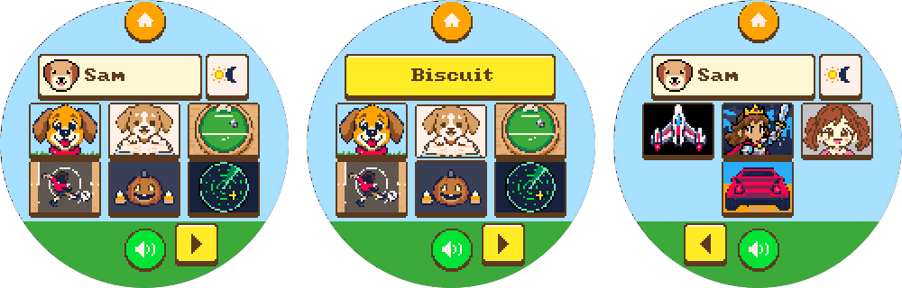
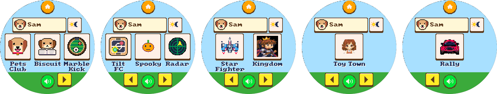
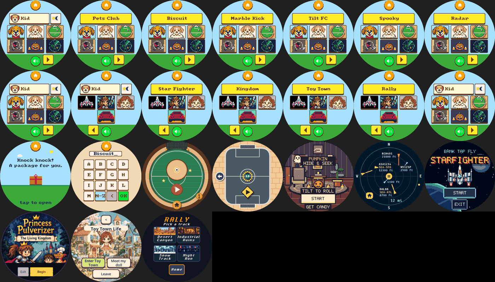

# Launcher: six games a page, pictures first

## Principles

1. **Fewer pages.** Six games share a page in two rows of three (`shell/launcher.h`), so ten games fit on two pages
   instead of five, and up to twelve fit before a third page appears. A short last row is centered.
2. **The picture is the name.** Each tile is a 38x28 picture filling its whole tile: one bold subject from that
   game's own world on that game's own background color, so two tiles never look alike and a kid who cannot read
   yet still finds their game. Names no longer fit under six tiles, so they are not drawn there.
3. **Names on demand.** A finger on a tile shows that game's name in the yellow caption over the header row; slide
   off and nothing opens. A tap opens the game, as before. The sim asserts every game's name fits the caption.
4. **Nothing else moves.** Home, who is playing, the sun, the mute button and the page arrows keep their places,
   sizes and behavior. Every tile is a whole 40x30 (13 x 10 mm) target inside the glass (`host/test_shell.cpp`).
5. **Each game owns its picture.** `games/<game>/art/launcher.png` -> `games/<game>/launcher_icon.h` through
   `tools/launcher_icons.py` (shell palette, integer cell voting, `--check` in `make lint`); `App::icon()` returns it.

## How the pictures were made

Codex CLI 0.160's built-in image tool, 2026-10-31, one request per game with that game's own screen attached
(`snap` after `app <store>`), so each picture keeps its game's colors and style. Originals were downscaled with
nearest-neighbor to 256x256 before committing. Shared prompt, with SUBJECT filled per row:

> The attached image is a screen from one of our kids' games. Use your built-in image generation tool to create ONE
> launcher icon for this game, matching that game's own colors and art style, then copy the resulting PNG into the
> current directory as a.png. Do nothing else. The icon: SUBJECT Style: chunky retro pixel art drawn as if on a tiny
> 38x28 pixel grid (every art pixel a big square block), very bold simple silhouette, thick dark outline, flat colors,
> high contrast, about 10 colors. Full bleed: the background color fills the whole image edge to edge. No border, no
> frame, no rounded corners, no text, no letters, no logos, no UI. Keep everything important inside the middle
> horizontal band (the top and bottom 13% will be cropped off). Square image.

| Game | Subject |
| --- | --- |
| `pets-club` | A happy golden-brown cartoon puppy face with big floppy ears, shiny black nose and a red collar, centered and large, on a bright sky-blue background with a strip of green grass at the bottom. |
| `biscuit` | A warm tan-and-cream puppy head and front paws resting on top of an open book, the whole puppy head fully visible in the vertical middle of the picture, on a plain flat cream background. Very few colors. |
| `marble-kick` | Seen from above: a shiny silver marble rolling across a round green wooden tilt-table football pitch with a little white goal, warm wood rim around it, on a light wood background. |
| `tilt-fc` | Top-down street football: a kid footballer in a red shirt kicking a white soccer ball on a grey asphalt pitch with white lines, a bit of sandy brick around the pitch. |
| `pumpkin-hide-seek` | A grinning orange jack-o'-lantern pumpkin with a little green stem and two candy corns beside it, centered and large, on a deep purple cozy-night background. |
| `plane-radar` | A round dark-green radar screen with glowing green rings, a bright sweep line and one yellow airplane blip, on a dark navy background. |
| `starfighter` | A white-and-blue starfighter with red stripes and twin engines flying upward, centered and large, over deep blue space with a few bright stars. |
| `living-kingdom` | A brave princess-knight girl with brown hair, a gold crown and a raised sword, shown from the chest up, centered and large, with a small castle silhouette behind her on a twilight blue background. |
| `toy-town-life` | ONLY the big smiling face and shoulders of a doll girl with two brown pigtails, rosy cheeks and a pink dress collar, filling most of the picture, on a plain flat mint-green background. Nothing else: no house, no flowers, no details. Very few colors. |
| `racing` | ONLY the back of one big red rally car filling most of the picture width (two round red tail lights, black tires, dark rear window), on a plain flat sandy road with a plain flat blue sky above. No rocks, no scenery details. Very few colors. |

Toy Town, Rally and Biscuit were regenerated once: the first pictures were too busy at 38x28, or cropped the
puppy's head. The second prompts above ask for one big subject and few colors.

## Black-box pass (emulator)

Played on the final build with ordinary input through `snap --serve` (fixture: `reset`, `tilt 0 1000 0`,
`profile Kid 8`; then only `down/move/up/tick/tilt/frame`). Each step was chosen from the rendered frames:

- Picked **Kid** on Who's playing?, landed on page one: six pictures, the right arrow, mute, sun and Home.
- Pressed each picture and read its name in the yellow caption (Pets Club, Biscuit, Marble Kick, Tilt FC, Spooky,
  Radar), sliding off each time: nothing opened.
- Right arrow to page two (Star Fighter, Kingdom, Toy Town, Rally, centered), the same press-and-slide for each, left
  arrow back to page one.
- From a fresh emulator each time, tapped every one of the ten pictures: each opened its own game's first page.

Inputs: [playthrough-inputs.jsonl](playthrough-inputs.jsonl) (each `start` is a fresh `snap --serve` after the
fixture). Observation, not changed here: Pumpkin's launcher name is "Spooky" while its title says Pumpkin Hide &
Seek. Not checked: a child finding a game by picture alone, and the device itself.
