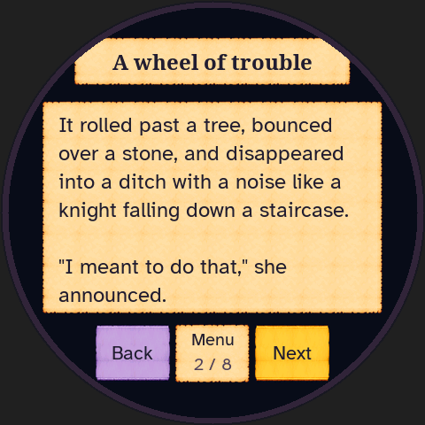
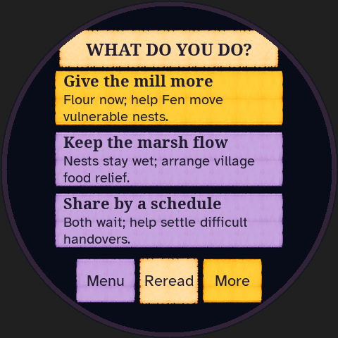
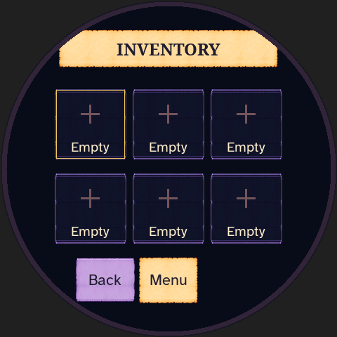
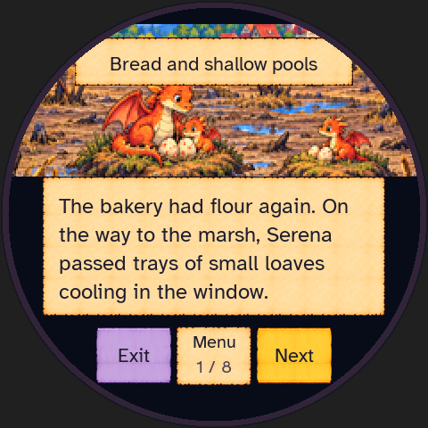
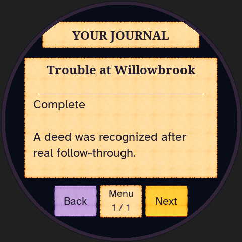
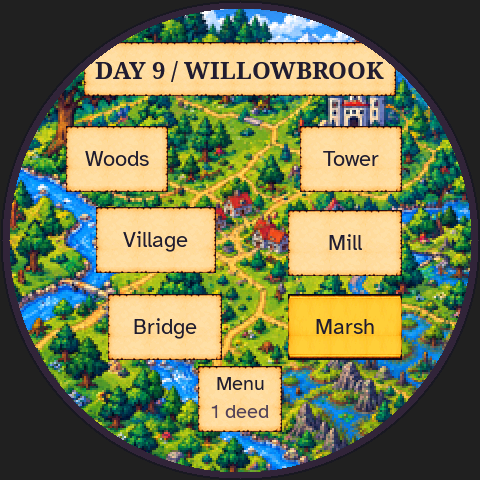

# Chapter One: final emulator evidence

The [main integration check](main-integration/README.md) covers the final
combined firmware source after PR #80's admin typography was merged. It adds
a watched launcher/reader/tools/save/restart pass (23/23 replay frames) and
replays all three complete campaigns with 218/218, 269/269 and 242/242 exact
matches against their copy-corrected captures. Kingdom source and art are
unchanged by that merge.

These are watched ordinary-input campaigns on the completed board08 visual
baseline, followed by narrow watched checks of four copy corrections. They are
not engine simulations or staged endings. The visual baseline SHA-256 is:

`6f40297c36fccf7d067c7f37aeeeacf2f29f0fa6416d5cca19832efcf33e87ce`

| Campaign | Evidence | Result |
| --- | --- | --- |
| Mill first | [Implementer report](mill-board08/README.md) | Complete ending, delayed nursery work, retained optional quests, post-ending visits; fresh replay 218/218 identical frames |
| Marsh first | [Designer report](marsh-board08/README.md) | Complete ending, flour consumed by relief work, post-ending bridge repair; fresh replay 269/269 identical frames |
| Costly channel | [Source-free independent report](channel-board08/README.md) | Complete paid-work/repair ending, deferred bridge and post-ending save/restart; fresh replay 242/242 identical frames |

The mill tester implemented the game; the marsh tester previously authored its
story. Their reports disclose that prior knowledge. A separate source-free
tester completed the costly second-channel route using only visible clues and
controls. The report also discloses prior play of an earlier shared-route build. All four
routes also have engine coverage across 128 seeds.

Each campaign starts fresh. Only the shell's parental allowance is configured
by [setup.py](independent/setup.py); profiles, story choices and progress come
from the visible interface. The traces include realistic reading waits, genuine
20-minute shell breaks followed by ordinary ten-minute waits, voluntary exits,
restarts and an abrupt process kill. Exact page/result/map recovery is verified
in the linked reports. No hidden progression commands are accepted by
[kingdom_replay.py](kingdom_replay.py). Replays check the recorded watched inputs
and do not replace the original live runs.

The current copy-corrected emulator SHA-256 is
`780fd0add1892afa4af35e29a9d1acc266d5baf7798e6bcb0ab3a8c2bd4eb246`.
The [clue/return-guidance addendum](marsh-board08/copy-addendum/README.md) and
[both woods routes](copy-woods/README.md) inspect the changed screens, backward
navigation, exits and exact save recovery. A fresh full mill replay matches all
218 baseline frames on this binary. The full marsh replay matches 268 frames;
its sole expected difference is the now-explicit mill destination, inspected in
the addendum. The full channel replay matches 241 frames and changes only the
corrected journal attribution; its current native difference is inspected and
linked in that report. No conditions, effects, controls or art changed.

The revised build passes the reader/reread/confirmation loop, one-time
commitments, inventory use, companions, journal, consequences, endings and
continued exploration. No blocking UI, save or progression defect was found.
The final copy pass fixes the marsh return destination and removes witness
attribution from clues that can be earned before meeting Pippa.

## Current screens

[Original-versus-final comparisons](../visual-comparison/README.md) include
native 480px captures and a 201px reading-size approximation. No physical-device
playtest or child usability study is claimed. The softer watchtower crop and
intentional layout differences are documented there.

Earlier rejected presentations and their functional test history remain in
the [historical index](historical.md). They do not certify the final visuals.
See [verification](../verification.md) for automated checks and firmware limits.
