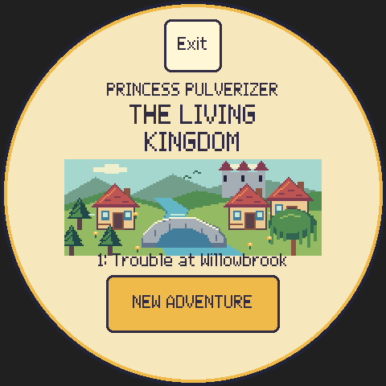
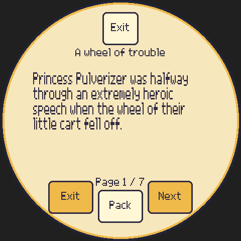
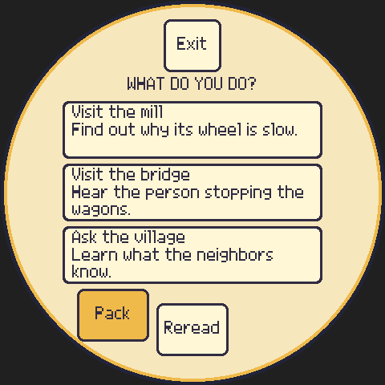
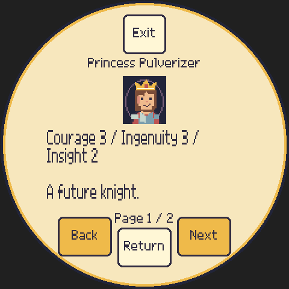
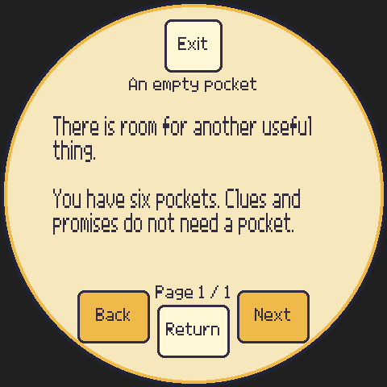
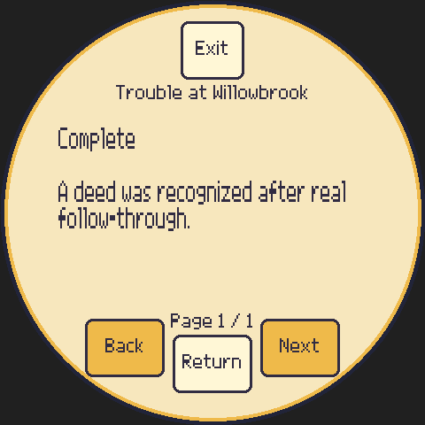
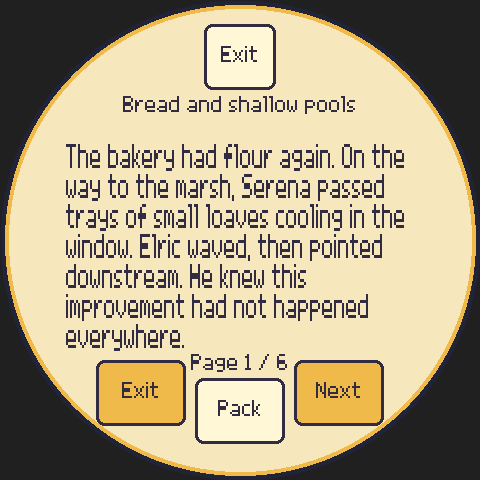
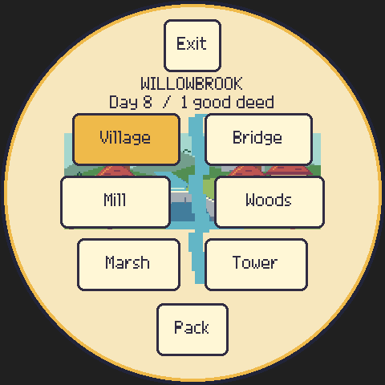

# Chapter One emulator evidence before the visual revision

**Historical functional evidence.** The user rejected the typography and art
shown in these screenshots. These reports and their binary identities predate
the visual revision based on the original nine-screen SVG, GPT-generated art,
and Atkinson typography. They preserve completed gameplay traces and observed
functional findings; they do not approve or verify the current presentation.
New watched runs of the revised, frozen build will be documented separately.

These reports document actual ordinary-input play in the rendered host
emulator, not staged endings or engine simulations. The implementer completed
mill first; two independent testers, without reading campaign source or
solutions, completed marsh first and timed sharing. The runs include saved
intermissions, realistic reading pauses, both kinds of voluntary exit, process
restarts, and the shell's parent-imposed break.

The archived pre-visual emulator SHA-256 is
`f5a1d7b8c4acbcd015c632ed0de9a9dcd2a49b5fdea800cd575f3e745336246d`.
Each report records the builds it actually used, exact touch/time traces,
fixtures, screenshots, findings and resolution. Mill and marsh reports include
archived-build replay comparisons; the independent sharing report explicitly
records that its fresh replay was deferred when the visual revision began.
Only the shell's 20-minute session / 120-minute daily policy was preconfigured; profiles and
campaigns start fresh through the visible UI. Reproduction uses
[`kingdom_replay.py`](kingdom_replay.py), which permits no hidden-state or
progression commands. Replays confirm traces after the watched live runs;
they do not replace those runs.

| Campaign | Evidence | Main coverage |
| --- | --- | --- |
| Mill first | [Implementer report](mill-first/README.md) | Seven-page reread loop, council confirmation, blocked channel explanation, delayed marsh crisis, two-day nursery work, actual parent rest/exact page resume, mill ending, retained quests, post-ending save/restart |
| Marsh first | [Independent art/route report](art-review/README.md) | Flour/supply work, marsh decision, delayed village relief, actual flour trade and work, marsh ending, portraits, changed locations, quiet revisits, approximate physical-size typography |
| Timed sharing | [Independent source-free report](independent/README.md) | Item/skill explanations, exact mid-reader resume, bridge inspection/repair, timed-sharing decision and delayed handovers, shared ending, quiet visits and optional work |

## Problems found and fixed in the archived builds

- Party, Items and Journal initially overprinted two footer counters. A shared
  compact page counter replaced the collision; archived screenshots and glyph
  versus control regression checks verify it.
- Choice subtitles could extend below their cards. Captions/details were changed
  to use separate measured lines, and the production choice set was checked
  against the fonts of that build. Rest copy also moved clear of controls.
- Lucas initially resembled the princess too closely. His hair, ear and
  expression were differentiated in that discarded visual treatment. This
  historical fix does not establish acceptance of the replacement art.
- Optional early NPC work could reopen a resolved quest. Resolved tracks now
  remain terminal for ordinary quest effects; tests cover late revisits.
- Returning to complete a main route could leave an already fulfilled optional
  return promise open. Actual follow-through closes existing promises without
  inventing promises the player did not make.
- Three late rumor/parcel passages still described the bridge as closed after
  safe repair. The corrected prose retains the lasting flood evidence without
  contradicting the player's completed repair.
- A destination with no eligible encounter had a blank activity caption. It
  was changed to say **A quiet visit**. Archived live traversal and replay review
  cover this renderer-only change.

The archived watched campaigns reported no crash, progression dead end,
repeated reward, or lost saved reading position. The testers' local layout and
readability observations belong to those builds. The user's subsequent rejection
of their visual design supersedes any suggestion of visual acceptance.
At the time of these reports, the costly second-channel ending had engine
coverage across 128 seeds but had not received a fourth full independent
ordinary-input campaign. Its unavailable explanation was inspected during the
archived mill campaign.

## Historical screenshot selection — rejected visual treatment

These screenshots show the archived presentation, not the current build.
All gameplay evidence here was captured at native 480 × 480 resolution. The
[physical-size comparison](art-review/README.md) approximates a 2.1-inch
diameter on a 96-ppi display and records the old body contrast. Browser scaling
and monitor density vary. No physical-device playtest is claimed.

See [verification](../verification.md) for the separately maintained check
status and build scope. These archived manual reports do not certify later
binaries, revised visual assets, or checks outside their recorded coverage.
