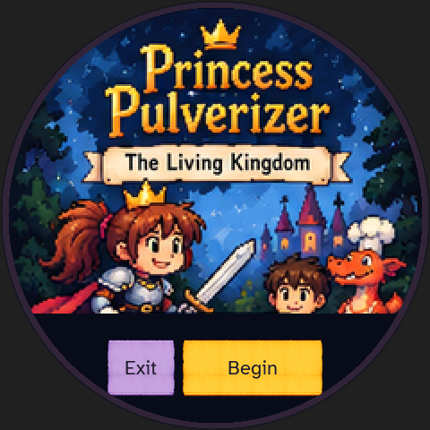
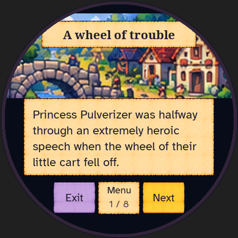
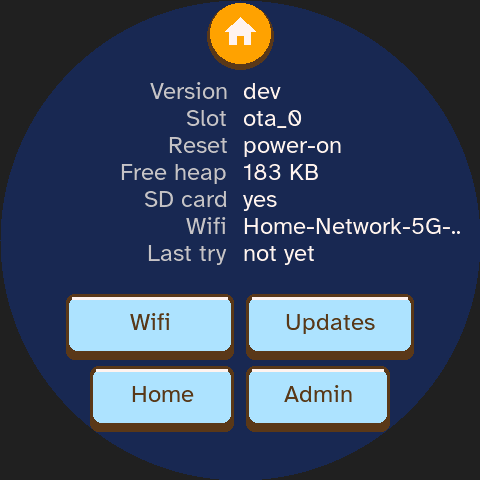
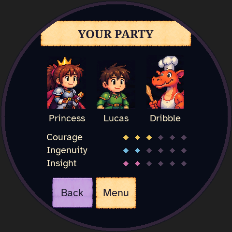
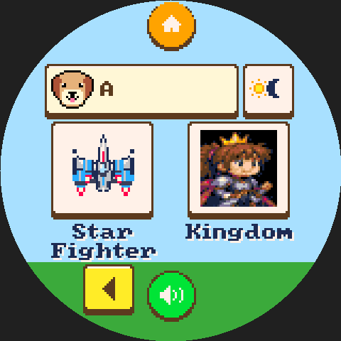

# Main integration: final emulator check

Tested 2026-10-19 at merge `2116f9132d38d43b4034b9f7b42a56878bdd2025`,
which integrates main's PR #80 adult typography and merged design PR #79.
Kingdom's code, content, artwork and tests are byte-identical to `07d9197`.
The combined ordinary emulator SHA-256 is:

`2bb76fc45af7902d4ed30629304380ba04f2aa15ecb1a8efd18c6003941b2d3b`

The implementer performed this narrow watched integration pass using
`snap --serve`, native 480×480 frames and ordinary visible touches. It starts
with an empty save directory, creates synthetic profile A through the UI,
selects the third launcher page, enters Kingdom and reads its opening. It
does not use campaign fixtures, hidden queries or progression shortcuts.
This checks shell integration; the full natural campaigns remain the
[mill](../mill-board08/README.md), [marsh](../marsh-board08/README.md) and
[independent channel](../channel-board08/README.md) reports.

Inspected the original-art title, illustrated opening, continuation page,
Back/Next, Party, Inventory and Adventure Pack. On opening page 2/8, killed the
emulator process abruptly, reopened it and traversed the picker/launcher/title:
Continue restored exactly the same native frame. Also entered the native
grown-up Info screen through the visible five-second picker hold, inspected
its readable Atkinson text, and returned through the normal picker.

Tool Return preserved page 2/8. Save & quit returned to the launcher; a graceful
process restart and ordinary launcher entry restored page 2/8 exactly again.
The run ended with Save & quit. No surface corruption, clipping, input or save
regression was observed. No gameplay/UI change was needed.

The [input trace](input.txt) records every touch, elapsed-time step, snapshot
and restart, including the actual forced kill. Its fresh replay matches all
**23/23** native frames ([result](live-replay.json)). The standard replay helper
configures only the shell's 20-minute session/120-minute daily allowance; the
watched pass used untouched defaults. This short pass reaches neither limit.
[Frame hashes](frame-hashes.json) retain all captures; selected PNGs below are
committed. The existing full-campaign traces were also replayed on this binary,
comparing against their copy-corrected frames:

| Trace | Identical frames | Record |
| --- | --- | --- |
| Mill campaign | 218/218 | [Result](mill-replay.json) |
| Marsh campaign | 269/269 | [Result](marsh-replay.json) |
| Channel campaign | 242/242 | [Result](channel-replay.json) |
| PR #80 adult typography | 51/51 | `python3 docs/adult-typography/replay_typography.py` |

These automated replays verify unchanged rendering and outcomes; they do not
claim new watched full campaigns. No physical-device test is claimed.

