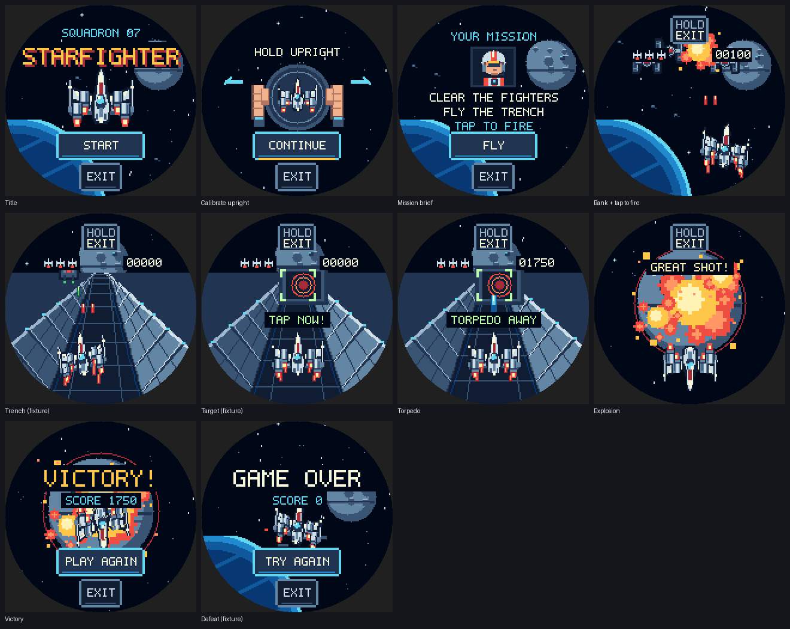

# Starfighter: playable first version

Starfighter is the seventh Porthole launcher entry, labeled **Star Fighter** so the
name fits the circular launcher. It is an offline, silent arcade game with no saved
progress: four increasingly busy fighter waves, a 45-second trench, a forgiving
final torpedo shot, and replay after victory or defeat.



## Controls

1. Hold the puck upright like a small steering wheel. Keep your comfortable grip
   still for 350 ms, then tap **CONTINUE** and **FLY**.
2. Bank left or right to move the ship. The neutral grip is calibrated, a small
   dead zone rejects wobble, and steering reaches its cap near 20 degrees.
3. Tap the glass for one paired red volley. A held finger does not autofire.
4. At the final port, line up the reticle and tap. A miss allows another pass.
5. Hold **HOLD EXIT** for 600 ms during flight. Menu and result screens have a
   normal **EXIT** button. Replay returns to calibration.

These controls use screen-plane gravity from the existing accelerometer input.
Flat tabletop yaw is not measurable, so calibration asks for an upright grip.
Pitch, gyro input, networking and sound are not required. Three lives and 1.6
seconds of invulnerability after a hit prevent a single burst consuming a run.

## Reproduce the screenshots

From `apps/porthole`:

```sh
make snap
./build/host/snap --fresh --script docs/starfighter/tour.txt
```

The checked-in PNGs are lossless conversions of the simulator's 480x480 BMPs.
[tour.txt](tour.txt) documents the provenance: title, calibration, brief and
squadron use the normal tap path; trench, target and defeat use deterministic
stage fixtures; the accepted target shot advances normally through torpedo,
explosion and victory. These captures exercise the actual App, input tracker,
update loop and renderer. They are not physical-device photographs.

The complete mission is also exercised without state shortcuts by the rule tests:
12 seeded aiming pilots finish in 145–147 seconds; a slower pilot with 400-ms
reactions and 600-ms taps wins 28 of 30 seeds. Those are simulation balance checks,
not claims about children's playtest results.

## Verified results

- All 62 repository simulator scenarios pass, with zero UI failures or warnings;
  this includes Starfighter's AddressSanitizer/UndefinedBehaviorSanitizer chaos run.
- Starfighter control/App tests pass 103 checks; rule tests pass 714,486 checks.
- The SDL host simulator builds and runs with the dummy video driver; the runtime
  screenshot tour and the 144 focused flow/control/stage/navigation checks pass.
- ESP32-S3 firmware builds without warnings: 6,944,030 / 8,323,072 bytes in its app
  slot (83.4%), 157,568 / 327,680 bytes static RAM (48.1%).
- Complexity, generated-art freshness, Python lint/format/type checks, secret
  scanning and SAST checks pass.

## Verification scope

- Control and App tests: calibration from upright and angled grips; invalid,
  moving, flat and stale sensor rejection; queued taps; replay; backward clocks;
  capped long frames; fresh-page touch guards; exit from every state.
- Rules tests: natural wins and idle defeat, four waves, difficulty ramp, visible
  wing collisions, heavy fighters requiring separate volleys, paired cannon
  origins, bounded projectile pools, hit immunity, turret collisions, unlimited
  target passes, stable accepted torpedo launch, restart and determinism.
- Simulator scenarios `90`–`94`: natural launcher navigation, all game states,
  steering/fire/life changes, final missed and accepted shots, replay and exits;
  touch/tilt chaos under AddressSanitizer and UndefinedBehaviorSanitizer.
- Generated art is checked against its source. Text and controls are logged for
  the repository's circular-layout, size, spacing and contrast audit.
- A separate code review checked state transitions, timing, buffers, hitboxes,
  circle geometry and the test coverage before the final gates.

No physical board was attached. Firmware compilation and host simulation do not
establish device frame rate, panel/touch operation, or comfort in a child's hands.
The first hardware session should measure update/render/present timing with `M`
and tune banking sensitivity and combat pressure with a child.
