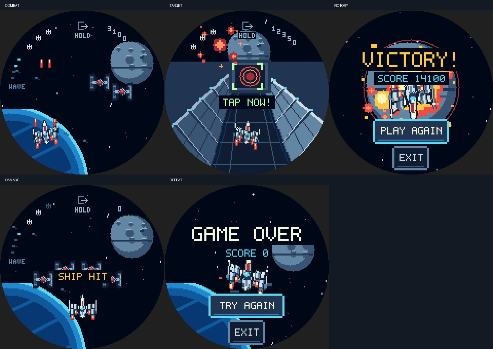

# Emulator playtest and refinement

The final build was played through the actual host emulator using only visible
touch and tilt input. A separate playtester did not read Starfighter source,
rules or tests, query hidden state, or use game-stage shortcuts. The coordinator
also played the emulator and inspected native 480×480 frames.

## What changed after playing

- Calibration now distinguishes **LIFT UPRIGHT**, **HOLD STEADY** and
  **READY TO FLY**. The mission explicitly teaches banking and tapping.
- Empty waits between defeated formations became a short reinforcement gap.
  Four wave markers show progress.
- Lives and score follow the circular rim. The exit sign is visually small,
  with its full hold target preserved. The horizontal HUD plates are gone.
- Fighters and turrets are smaller; the player is about 90 pixels wide.
  Cannon origins, engine trails and collision geometry match the artwork.
- Damage says **SHIP HIT**, and the trench entrance says **DODGE AND FIRE**.

## Observed results

The final ordinary-input run reached **VICTORY**, scored **14,100**, and kept all
three lives. Small sprites, red outgoing shots, green incoming fire and orange
explosions remained distinguishable. The five-digit curved score and life icons
stayed readable. The final sequence communicated **LINE UP**, **TAP NOW!**,
**TORPEDO AWAY** and **GREAT SHOT!** before victory.

The coordinator's separate run used shorter repeated sweeps and ended in the
trench at 12,300 points. The longer dodges in the successful trace avoided those
attacks. The trench still demands movement; a win is not guaranteed by firing.

Replay reset score, lives and wave progress. A partial exit hold showed progress;
dragging away canceled it, and a deliberate hold returned to the launcher.
On a separate idle run, real attacks removed lives, displayed **SHIP HIT**, and
led to **GAME OVER**. **TRY AGAIN** started a fresh run through calibration.

No actionable rendering or playability issue remained in these observed flows.
This is an agent-operated emulator playtest, not a child or physical-device
study. The automated aiming and novice cohorts are reported separately in the
[main verification notes](../README.md), including their sensitivity to steering.

## Evidence and reproduction

The five PNGs here are unaltered emulator frames captured during ordinary play.
They differ from the deterministic stage fixtures in the parent screenshot tour.
[victory-inputs.jsonl](victory-inputs.jsonl) preserves all 490 requests through the
first victory frame; each `commands` array contains only ordinary input/time
commands, and `snap` names the frame inspected after that request.
Replaying these requests in a fresh emulator process reproduced the saved victory
frame pixel for pixel.

The shell profile **Pilot**, age 8, was prepared with `reset` and `profile Pilot 8`
before starting a new `snap --serve` process. The recorded run then selected that
profile and navigated the launcher normally. Profile creation itself was a shell
fixture; no Starfighter state was prepared or inspected.

To replay, build `make snap` in `apps/porthole`, create an isolated working
directory with `build/host/`, prepare that profile using `snap --script`, and
start the same binary with `--serve` in that directory. Send every recorded
command in order and read its response line. At each `snap`, send `frame`, read
the `PPM <byte-count>` header and that many RGB bytes (480×480). These are the
ordinary emulator protocol commands; do not translate `tick` into script-mode
`wait`, whose stepping differs. The full trace includes the visible launch-input
retry after a transport interruption, rather than silently editing it out.
