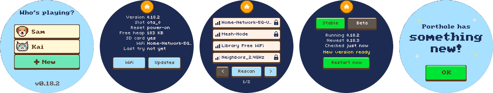

# Put Porthole on a board

The easiest way is the step-by-step guide at [porthole.dreamiurg.net](https://porthole.dreamiurg.net/).
This page has the same steps and the details behind them.

## Install from the browser

This way needs no tools:

1. Download `<app>-<version>-factory.bin` from the [releases](https://github.com/dreamiurg/porthole/releases).
2. Connect the board over USB-C.
3. Open [esptool-js](https://espressif.github.io/esptool-js/) in Chrome or Edge.
4. Write the file at address `0x0`.

This erases the board, saved progress included. To keep saves, write the separate parts from
`<app>-<version>-web.zip` at the offsets in its `parts.json`. The web installer does this. You can also
build from source and run `make flash` (see [development.md](development.md)). With esptool, from the unzipped parts:

```sh
esptool --chip esp32s3 write-flash 0x0 bootloader.bin 0x8000 partitions.bin 0xe000 boot_app0.bin 0x10000 firmware.bin
```

esptool 4 spells the command `write_flash`. Do not give `--flash-mode` or `--flash-freq`. They change the
bootloader header, and a mode the board cannot run (`qio`) puts it in a watchdog reset loop. To recover,
write the parts again without those options.

## Updates over Wi-Fi

You need the USB cable only once. After that, the board updates itself over Wi-Fi.



Once a day, when nobody plays and the screen is dark, the board looks for a new version and downloads it.
The screen dims by itself after a few minutes. If someone wakes the screen, the download stops. It
continues the next time the screen is dark. The new version starts the next time someone switches the
board on, and the kids see a "Porthole has something new!" card. Saves and profiles stay. The board sends
nothing about the kids.

To give the board your Wi-Fi, use one of these:

- **On the board (easiest).** Open the hidden menu (below) and tap **Wifi**. Pick your network and type
  its password. The board tries it at once and keeps it only if it connects, or if you tap **Save anyway**.
  A network with no password skips the typing.
- **microSD card.** Make the file `/porthole/wifi.txt`. Put the network name on line 1 and the password on
  line 2. Put the card in the board and switch it on.
- **USB cable.** Open a serial monitor at 115200 baud on either USB-C port. Send `W`, the network name, a
  tab, and the password, for example `WHomeWiFi`, a tab, then your password.

## The grown-ups' menu

On "Who's playing?", hold the title for 5 seconds.

- **Info** shows the version, the Wi-Fi, the SD card and other details.
- **Wifi** lists the networks near the board.
- **Updates** shows the running and newest versions and lets you pick Stable or Beta. **Check now**
  downloads at once (about a minute, with a percentage and a Cancel control). **Restart now** appears when
  an update is ready.

The running version also shows in small print at the bottom of "Who's playing?".

- **Stable** (the default) gets a beta once it has been out for three days and nobody yanked it.
- **Beta** gets each new version as soon as the release workflow builds it.

How betas become stable is in [releases.md](releases.md).
