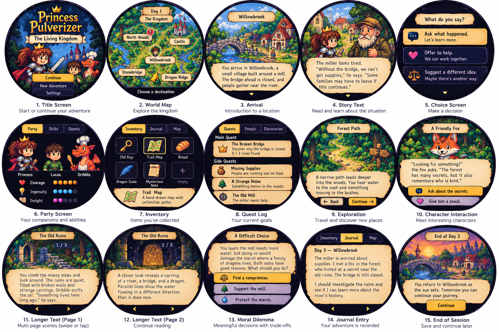
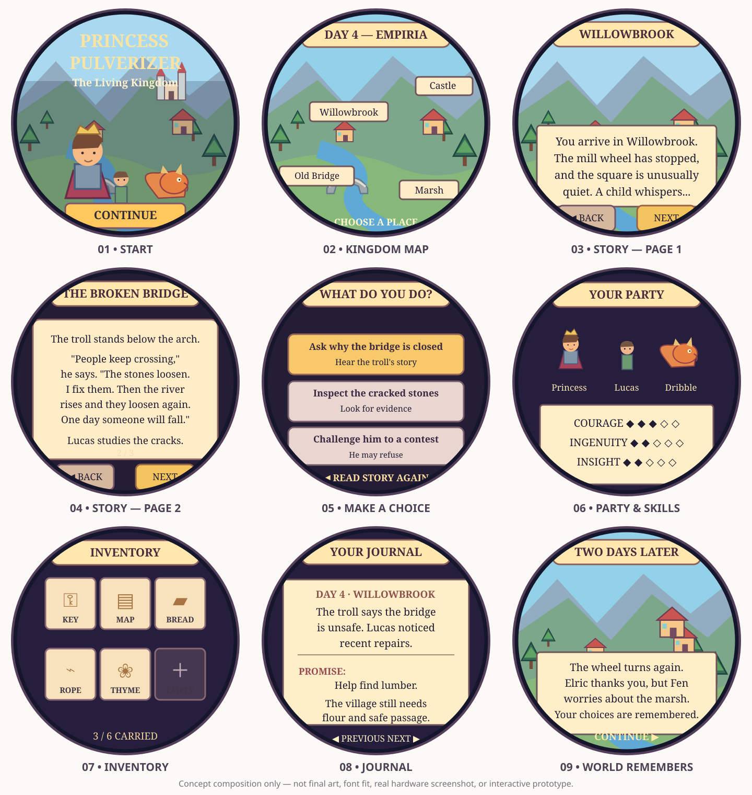

# Princess Pulverizer: The Living Kingdom — Chapter One design package

This folder is the **complete design handoff** for an implementation agent. It intentionally contains no gameplay implementation. Use the branch `design/living-kingdom-chapter-one` as the source base for the Codex Cloud session.

| File | Purpose |
| --- | --- |
| [CODEX-TASK.md](CODEX-TASK.md) | **START HERE:** implementation goal, scope, autonomous playtest loop and validation checklist |
| [v0.1-game-design.md](v0.1-game-design.md) | Approved game direction, art, mechanics, platform constraints, outcome requirements |
| [ux-flow.md](ux-flow.md) | Multi-page prose reader, **reread-before-choice**, auto-save and circular-screen interaction |
| [chapter-01-story.md](chapter-01-story.md) | Character voices, original starter manuscript, multi-day Willowbrook quest, resolution variants |
| [chapter-01-world.json](chapter-01-world.json) | Example location/quest/encounter IDs, scenario seeds and consequence graph (design fixture; normalize in code) |
| [content-contract.md](content-contract.md) | Stable extensibility, deterministic procedural variation, saves, migrations, validator and tests |
| [starter-screens.svg](starter-screens.svg) | **Nine round-screen layout/storyboard sketches**: start, map, reading, choices, party, inventory, journal, future return |
| [Original concept-art PNGs](concept-art/README.md) | Eight unchanged 1536×1024 boards; **08 — Chapter One: Polished UX** is the selected visual style |

## The game in one paragraph

An advanced third-grader plays Princess Pulverizer traveling with Lucas and Dribble in a persistent storybook kingdom. Read several pages of humorous prose, reread before a difficult choice, then act. Visit six areas of Willowbrook to resolve intertwined problems involving a dangerous bridge, flour shortages and river water needed by both villagers and marsh creatures. Decisions have costs, NPCs remember, and consequences unfold across in-game days. The first chapter is playable over 3–5 sessions and ends conclusively while the world remains alive for future chapters.

## Visual samples

The selected visual style is
[08 — Chapter One: Polished UX](concept-art/08-chapter-one-polished-ux.png):
colorful illustrated **pixel fantasy**, expressive characters, detailed landscapes,
deep indigo framing, parchment text areas and gold touch actions. All eight
[original PNG boards](concept-art/README.md) are committed unchanged at 1536×1024.

The SVG below is a **schematic layout reference**, not the selected artwork or
a replacement for the PNGs.

## Prototype definition

The engine should be expandable to Chapter Two without rewriting the UI/game logic, while Chapter One works immediately and can be playtested in the existing emulator. Do not confuse an extensive configuration system with finished playable fiction: build both core mechanics and enough authored encounters for meaningful repeated play.

## Licensing note

Princess Pulverizer and the core companion names originate in Nancy Krulik's books. This is an unofficial private fan prototype. No original book prose or art is included. Public distribution may require permission or character/world substitution.
