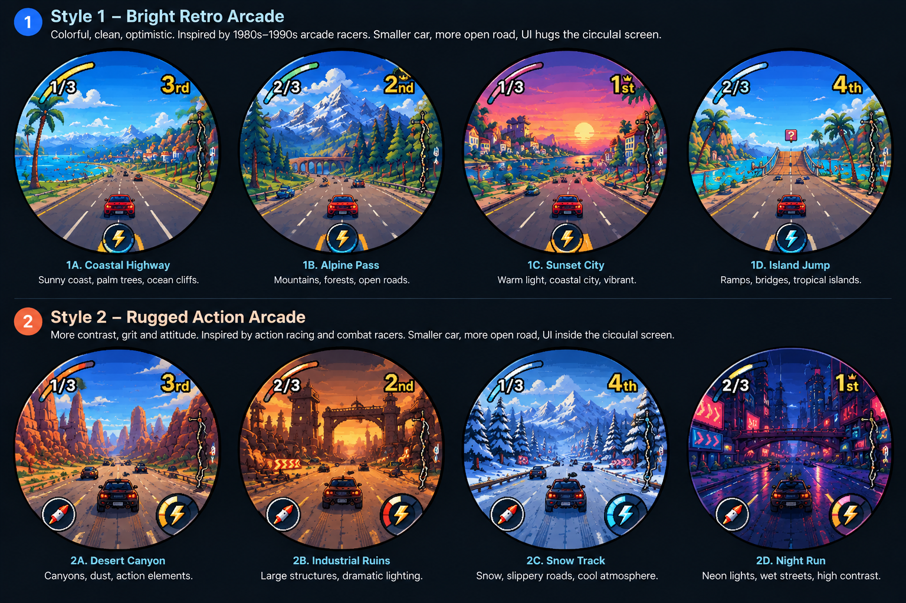
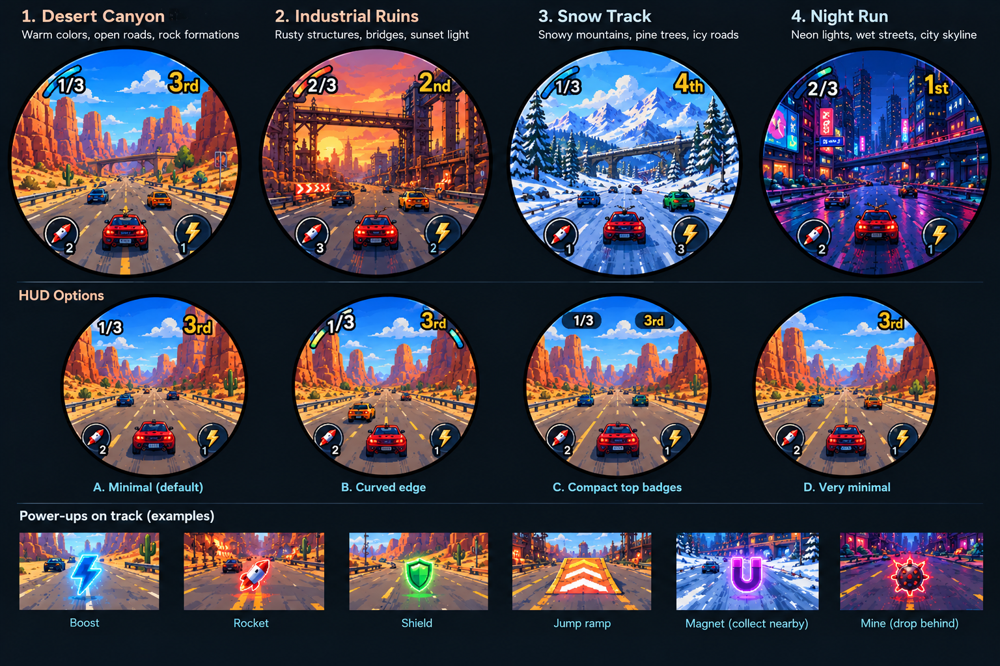

# Porthole Racing — design handoff

Design-only package for a short arcade racer on the round 480×480 Porthole. Turn the device like a steering wheel, collect Boost and Rocket charges, jump over trouble, and race for position. Cars never die. This branch adds no game implementation.

| Read | Purpose |
| --- | --- |
| [Gameplay brief](gameplay-brief.md) | Required mechanics, proposed tuning, steering, circular HUD, race flow |
| [Four tracks](tracks.md) | Desert Canyon, Industrial Ruins, Snow Track, Night Run |
| [Platform and acceptance](implementation-contract.md) | Verified repository constraints, integration dependencies, completion checks |
| [Original artwork and provenance](assets/README.md) | Two actual PNGs, checksums, selected panels, source inventory |
| [Codex task](CODEX-TASK.md) | Self-contained implementation handoff |

## Visual direction

The selected direction is **Style 2 — Rugged Action Arcade**, the bottom row of this original board. Panels **2A–2D** correspond to the four requested tracks. Preserve the small rear-view car, open road, strong silhouettes, warm canyon/industrial scenery, cold snow scenery, and vivid neon night. The top row is historical exploration, not another set of levels to build.

The user subsequently supplied the four-track showcase below, with four HUD options and pickup examples. Its top row supplies more detailed references for all four tracks; its action buttons show the requested integer inventories.

Both images are style references. The written brief overrides obsolete elements: remove charge rings, shields/health, and the mini-map; simplify lap/place; put complete touch targets inside the glass. Shield, Magnet and Mine pictured on the showcase are exploration outside this game's agreed scope. HUD A is labeled “Minimal (default)” in the artwork, but supplying this image does not separately approve a HUD option; use the written HUD contract. HUD D omits laps and is not compliant. Do not reproduce oversized traffic or control clipping from a concept panel.

## What is confirmed, proposed, and unavailable

- **Confirmed by the user:** four named tracks, round 480×480 display, steering by device rotation, Boost and Rocket, road pickups capped at three, jumps, collisions that cost speed/rank, no death/lives/health/shield, simple HUD, restrained traffic and small car.
- **Proposed design defaults:** three laps, four racers, 90–120 second clean runs, separate inventories of three per type, exact coordinates, tuning, AI and pause behavior below. These have not been playtested or approved individually.
- **Verified repository baseline:** `fedf62ce0c804dcb20ef3e7e7ee11ba9545cecb8`; the integration contract distinguishes current capabilities from racing work still needed.
- **Available source images:** `generated-image.png`, 1536×1024, 2,390,407 bytes, from the referenced ChatGPT conversation; and `level-showcase-upload.png`, 1536×1024, 2,490,306 bytes, supplied directly by the user in this continuation. Both are preserved byte-for-byte.
- **Unverified source identity:** the new upload visually supplies the requested four-track/HUD showcase, but its clipboard filename does not establish byte identity with the earlier `/mnt/data/a_clean_concept_art_game_ui_level_showcase_poster.png`. Its actual upload name and hash are documented instead.
- **Still unavailable:** `a_clean_concept_art_game_ui_moodboard_poster_in.png`. The chat reader did not return that binary and `/mnt/data` is not mounted here. It is not replaced or claimed as delivered.

Source: ChatGPT conversation `6acfa02b-4738-83ea-a3f5-9733fac03df8`, “Porhole Games”, and the user's explicit continuation request. This package contains the relevant decisions, so implementation does not depend on reading that chat.

The two available boards support implementation. The moodboard remains missing, and the showcase's historical filename identity remains unverified; **the requested three-file artwork transfer is not claimed complete**. See [asset recovery](assets/README.md#missing-originals).
