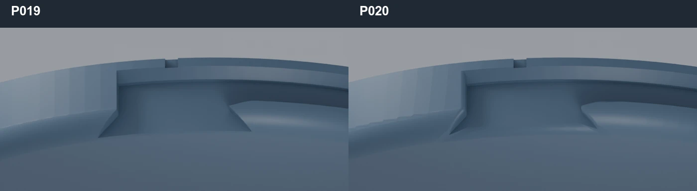

# P020 comfort lid

The lower corners of the puck’s three bayonet entrances rest against the fingertips during handheld play. P020 rounds those corners and blends the recessed entrance into the underside. The recessed lower lip blends into the underside with a 1.25 mm radius. The two outside cheeks and the retaining nose have 0.50 mm rounds, and the transverse corner of the trailing guide has a 0.65 mm round. The rising shelf also has a local blend confined to its outermost 0.36 mm near the entrance. The lock keeps the 40° P004 travel.

**For an existing puck, print only the [P020 lid for Bambu Studio](bambu/P020-lid.3mf).** The [standalone STL](P020-lid.stl) is also floor-down. Transfer the three lid screws. To insert the puck with the screen upright, start 40° counterclockwise from vertical and twist clockwise to the stop.

For a complete case, also print the [P014 two-color bezel](bambu/P014-Pinstripe.3mf), [board plate](puck_plate.stl) and [power slider](puck_slider.stl). The two bezel meshes are in [components](components/).

Regenerate the lid with `cad run hardware/case/puck_twist_p020.py` from the repository root.
