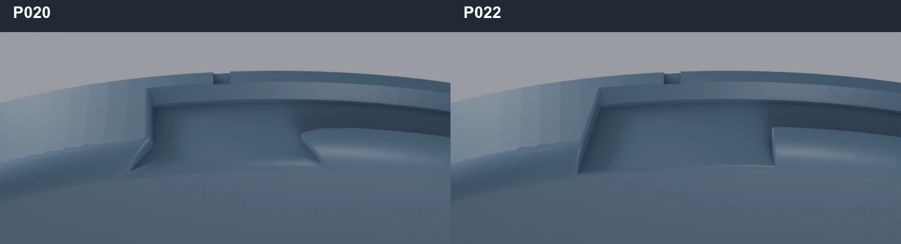

# P022 bayonet entry trial

Viewed from the side of the puck, the left mouth face is a single full-height bevel. The retaining lip on the right begins with a vertical face. The three entrances still lead into the 40° P004 locking tracks.

Print one [P022 lower lid for H2D](bambu/P022-lid.3mf), or use the [lid STL](P022-lid.stl). To finish a new case, print the [P014 bezel](bambu/P014-Pinstripe.3mf), [P021 middle plate](bambu/P021-plate.3mf), and [slider](puck_slider.stl).

To open the three-piece inspection assembly, run `blender -b -P hardware/case/assemble_r7_blender.py` from the repository root and open `preview/Puck-case-assembly.glb` in a model viewer. The bezel, plate, and lid are separate objects and use contrasting colors.
