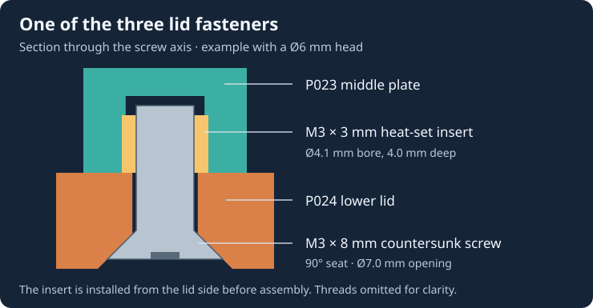

# R8 puck case with M3 heat-set inserts

For an existing puck, print the **[P023 middle plate and P024 lower lid together](bambu/P023-P024-H2D.3mf)**. The two parts share a new three-screw pattern. The P014 bezel, power slider and the wheel’s 40° twist lock fit this pair.

Bambu Studio estimates 53 min 58 s and 29.67 g of PLA for both parts on one H2D plate. Individually, P023 takes 22 min 40 s and 9.48 g. P024 takes 36 min 51 s and 20.22 g.

| Part | Bambu Studio project | Individual mesh |
| --- | --- | --- |
| P023 middle plate | [H2D plate](bambu/P023-plate.3mf) | [P023 STL](P023-plate.stl) |
| P024 lower lid | [H2D lid](bambu/P024-lid.3mf) | [P024 STL](P024-lid.stl) |
| P014 two-colour bezel | [Pinstripe project](bambu/P014-Pinstripe.3mf) | [Bezel body](components/P014-bezel-body.stl) and [accent ring](components/P014-bezel-pinstripe.stl) |
| Power slider | | [Slider STL](puck_slider.stl) |

## Fasteners and assembly

Use three **M3 × 3 mm heat-set inserts** with a measured 4.50 mm knurled diameter and 3.90 mm pilot diameter. The matching lid takes three **M3 × 8 mm flat-head machine screws** with a 90° countersink. The 8 mm length includes the head. The existing side screws still secure the bezel.

1. With the middle plate out of the case, heat-set one insert into each post from the lid side. Seat each insert flush with the flat end of its post and let it cool.
2. Fit the board, power slider and bezel, then route the battery lead through the middle plate opening. Keep the lead clear of the lid and the cell pouch.
3. Bring the lid and plate together and tighten the three machine screws by hand. Each nominal Ø4.10 mm insert pocket is 4.00 mm deep. A 90° screw with a 6.0–6.7 mm head leaves about 0.5–0.85 mm under its tip.

## Model sources

From the repository root, run `cad run hardware/case/puck_plate_p023.py` and `cad run hardware/case/puck_twist_p024.py` to regenerate the two STLs. Run `blender -b -P hardware/case/assemble_r7_blender.py -- --kit r8-insert-plate --plate P023 --lid P024` to create an inspection model at `preview/Puck-case-assembly.glb` in this folder.
